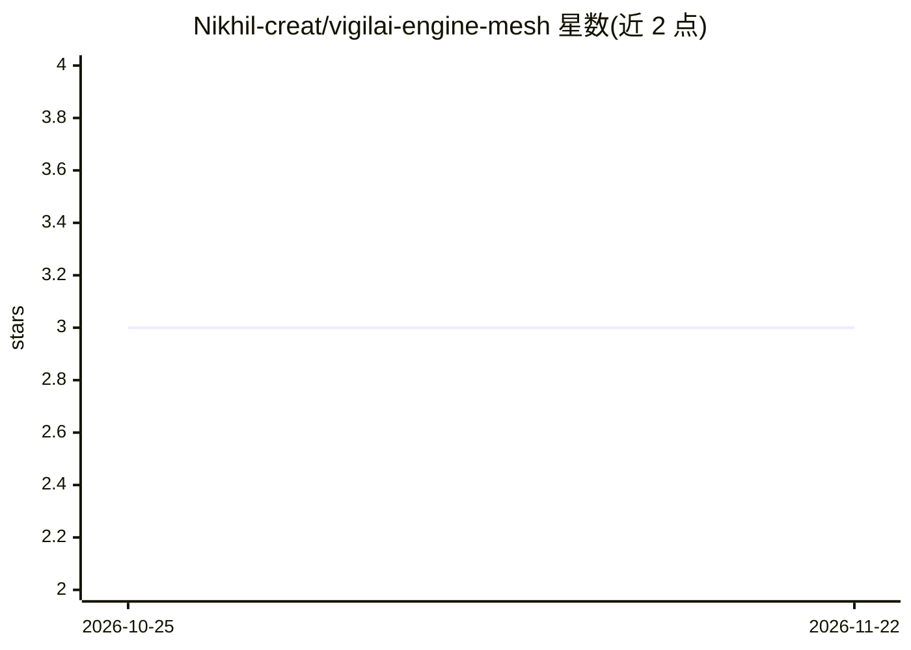

# Nikhil-creat/vigilai-engine-mesh

⭐ 3 · Python · 推送 2026-10-16 · [GitHub](https://github.com/Nikhil-creat/vigilai-engine-mesh) · [官网](https://nikhil-creat.github.io/vigilai-engine-mesh/) · 个人维护

**面向企业的分布式 vLLM 推理与 RAG 网关基础设施**

Docker Compose 部署的 AI 基础设施骨架：FastAPI 网关串联 guardrails、语义缓存、QoS 分级调度、Agent 规划、混合多模态 RAG（dense+BM25+GraphRAG 三元组）、CNN 视觉（ONNX/TensorRT）与 vLLM 分布式推理（张量/流水线并行、前缀缓存、投机解码、FP8/AWQ/GPTQ 量化）。可观测性由 Prometheus/Grafana/DCGM 容器承担，附 Locust 基准脚本、SHA-256 审计链与测试。需 NVIDIA GPU 主机；作者声明完整 GPU 栈未经端到端运行，部分特性（PP 多节点、MCP、LoRA 路由、K8s 自动扩缩）尚在计划中。

## 筛选速览

| 维度 | 判定 | 备注 |
|---|---|---|
| AI 角色 | `ai-ecosystem` | LLM/agent 周边工具 |
| 许可风险 | `none` | — |
| 部署形态 | `self-host` | docker 或自建部署 |
| 模型依赖 | local-ok | 支持本地模型 |
| 硬件要求 | — | 无带数字的原话,不猜 |
| 安装摩擦 | `low` | 无编译、无系统依赖或容器化 |
| 成熟度 | `idea` | |

## 能力要点

- vLLM 分布式推理：TP/PP 并行、前缀缓存、投机解码、FP8/AWQ/GPTQ 量化
- QoS 分级网关：加权调度、防饥饿/降级、租户语义缓存与 KV 预热
- 混合 RAG：dense+BM25 索引与 GraphRAG 三元组摄取，SSE/WebSocket 流式输出
- Prometheus 指标规范、记录规则与告警，附 Locust 基准与审计链

## 适用场景

- 在 NVIDIA GPU 主机上以一套 docker compose 部署 LLM 推理与 RAG 服务
- 为多租户 API 网关配置分级 QoS 与语义缓存
- 对推理栈做 TTFT/TPOT/队列延迟基准测试与 GPU 成本核算
- 为流式输出加 PII/注入/grounding 类防护栏

## 场景标签

`推理引擎` `RAG` `模型量化` `模型网关` · 领域:Agent 开发

## 证据(README 行号)

> L3: Unified AI infrastructure backbone: distributed LLM inference (vLLM), agentic orchestration, hybrid multimodal RAG,
> L15: Request path: **Client → Guardrails → Semantic cache → QoS router/queue → Agent planner → RAG ∥ CNN ∥ memory → vLLM
> L34: Requires an NVIDIA GPU host with `nvidia-container-toolkit`. Keys are `key:tier:tenant` in `API_KEYS`.

## 星数曲线

2026-10-25 3 → 2026-11-22 3（+0）

---
*卡片 v1 · prompt 1.4 · 生成 2026-11-22 · 置信度 high · 依据 README sha `e57917ee947c` · [字段定义](../../DATASET.md)*
