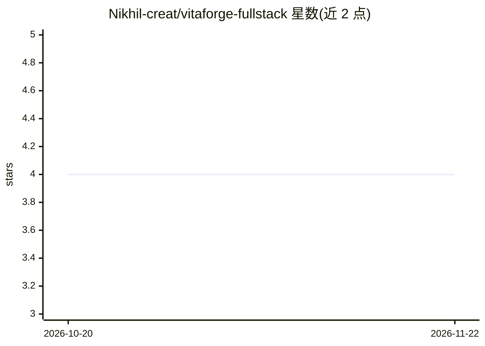

# Nikhil-creat/vitaforge-fullstack

⭐ 4 · Python · MIT · 推送 2026-10-10 · [GitHub](https://github.com/Nikhil-creat/vitaforge-fullstack) · [官网](https://nikhil-creat.github.io/vitaforge-fullstack/) · 个人维护

**求职者上传简历，获得 ATS 评分与 AI 重写的一页简历**

FastAPI + 浏览器前端的全栈应用：上传 PDF/DOCX/TXT 简历后，本地按 10 项规则打 ATS 分，agent 流程（诊断→RAG 检索→改写→批评→修订→护栏）重写为一页 ATS 友好简历，虚构数字替换为 [X]；导出 DOCX/PDF/TXT/HTML。后端调用 Groq API（llama-3.3-70b 与 llama-3.1-8b），API key 仅存服务端，含每 IP 限速、CSP 等安全措施；API 不可用时可用本地模板离线构建。

## 筛选速览

| 维度 | 判定 | 备注 |
|---|---|---|
| AI 角色 | `ai-native` | 本体是模型或模型工具 |
| 许可风险 | `permissive` | MIT |
| 部署形态 | `self-host` | docker 或自建部署 |
| 模型依赖 | locked-api |  |
| 硬件要求 | — | 无带数字的原话,不猜 |
| 安装摩擦 | `low` | 无编译、无系统依赖或容器化 |
| 成熟度 | — | 结构信号不足 |

## 能力要点

- agent 流程：诊断→RAG 检索→改写→critic→修订→guardrail
- 本地 ATS 评分（10 部分规则）与一页自适应排版，导出真实 DOCX/PDF
- AI 面试问题、模拟面试反馈、求职信、LinkedIn 文案与流式聊天
- PWA、Docker、GitHub Pages/Render 部署配置齐全

## 适用场景

- 上传简历获取 ATS 评分与修改清单
- 生成适配职位描述的定向简历与求职信
- 练习面试并获取 STAR 式改进反馈

## 场景标签

`AI 写作` `RAG` · 领域:内容生成

## 证据(README 行号)

> L4: Upload a resume → ATS score + fix list → AI agent rewrites it into a one-page, ATS-safe resume. FastAPI backend call
> L16: - **Agent** (`/api/agent/run`): diagnose → RAG retrieve → rewrite → critic → revise → guardrail. Any number the mod

## 星数曲线

2026-10-20 4 → 2026-11-22 4（+0）

---
*卡片 v1 · prompt 1.4 · 生成 2026-11-21 · 置信度 high · 依据 README sha `c4fcc0fe96b0` · [字段定义](../../DATASET.md)*
