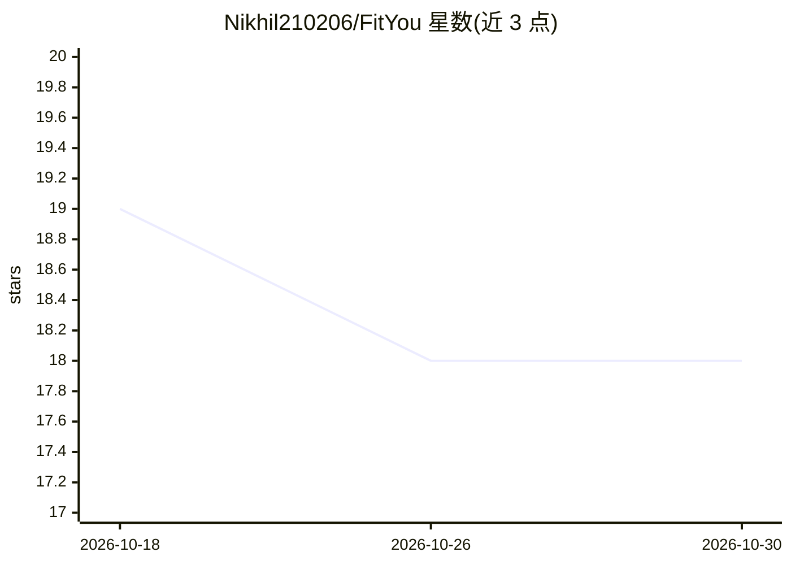

# Nikhil210206/FitYou

⭐ 18 · HTML · 推送 2026-07-02 · [GitHub](https://github.com/Nikhil210206/FitYou) · [官网](https://fit-you-six.vercel.app/) · 个人维护

**面向健身用户的 AI 个性化训练与饮食计划网站**

FitYou 是一个 React.js 前端 + Flask 后端的健身 Web 应用：用户注册并填写健身目标、活动水平与可用器械后，系统生成个性化训练计划与定制饮食计划（含印度菜系、60% 素食/40% 荤食配比），并支持进度跟踪与教练咨询入口。个性化推荐由 Scikit-learn 预测模型驱动，交互功能调用 Google Generative AI API，用户数据存于 MongoDB。本地运行需同时启动 Flask 后端与 React 开发服务器。README 列出可穿戴设备集成、多语言等未来增强项。

## 筛选速览

| 维度 | 判定 | 备注 |
|---|---|---|
| AI 角色 | `ai-native` | 本体是模型或模型工具 |
| 许可风险 | `none` | — |
| 部署形态 | `library` | 以包/库形式分发 |
| 模型依赖 | — | README 未给出锁定关系 |
| 硬件要求 | — | 无带数字的原话,不猜 |
| 安装摩擦 | `low` | 无编译、无系统依赖或容器化 |
| 成熟度 | — | 结构信号不足 |

## 能力要点

- 基于用户目标/器械/活动水平生成个性化训练计划
- 定制饮食计划，聚焦印度菜系（60% 素食/40% 荤食）
- Scikit-learn 预测模型 + Google Generative AI API
- 进度跟踪与教练/导师咨询入口

## 适用场景

- 获取符合自身目标与器械条件的训练计划
- 按印度饮食偏好获得定制餐单
- 在应用内跟踪健身进度并调整计划

## 场景标签

 · 领域:健康/健身应用

## 证据(README 行号)

> L11: FitYou redefines fitness with **AI-driven personalized plans** for workouts and diets. Empowering your fitness jour
> L32: - 🤖 **AI-Powered Insights**
> L45: - **Machine Learning:** **Scikit-learn** powers the predictive modeling for personalized recommendations.
> L47: - **AI API:** **Google Generative AI** for advanced language understanding and enhanced interactive features.

## 星数曲线

2026-10-18 19 → 2026-10-30 18（-1）

---
*卡片 v1 · prompt 1.4 · 生成 2026-10-29 · 置信度 high · 依据 README sha `2394a069f4e0` · [字段定义](../../DATASET.md)*
