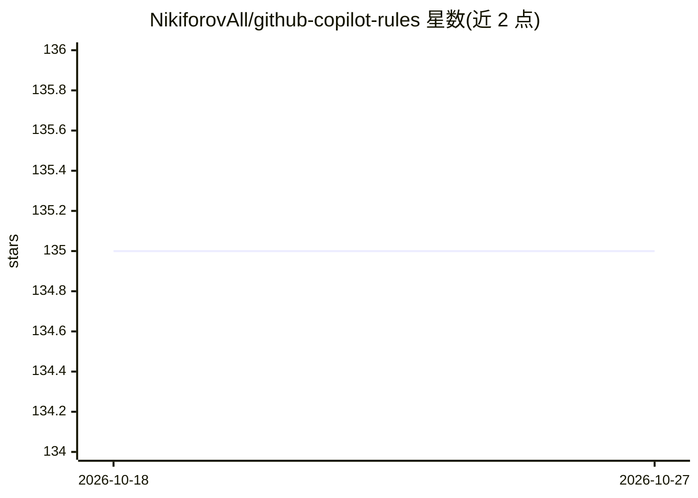

# NikiforovAll/github-copilot-rules

⭐ 135 · MDX · Apache-2.0 · 推送 2026-02-28 · [GitHub](https://github.com/NikiforovAll/github-copilot-rules) · [官网](http://nikiforovall.blog/github-copilot-rules/) · 个人维护

**GitHub Copilot 定制化规则合集：指令、提示词、agent 与技能**

策展式的 GitHub Copilot 自定义配置集合：提供 .github/ 目录下的 instructions（编码规则、测试、提交格式）、prompts（提交信息、复盘、对比）、agents（代码审查、调试、研究、规格访谈）与 skills（多会话规划、.NET 测试/脚本/依赖审计）四类文件，用户将所需文件复制进自己的项目并配置 VS Code settings.json 生效。以 Docusaurus 网站形式提供完整文档，安装方式为复制文件而非安装包。

## 筛选速览

| 维度 | 判定 | 备注 |
|---|---|---|
| AI 角色 | `ai-knowledge` | 知识聚合/清单类 |
| 许可风险 | `permissive` | Apache-2.0 |
| 部署形态 | `None` |  |
| 模型依赖 | — | README 未给出锁定关系 |
| 硬件要求 | — | 无带数字的原话,不猜 |
| 安装摩擦 | `medium` | 含编译或系统依赖之一 |
| 成熟度 | — | 结构信号不足 |

## 能力要点

- 四类定制文件：instructions / prompts / agents / skills
- 含 code-review、debug、research 等 5 种自定义 agent 模式
- skills 面向 .NET：测试运行、脚本执行、依赖审计
- 配套 Docusaurus 文档站点

## 适用场景

- 为团队项目快速接入 Copilot 编码与提交规范
- 让 Copilot 以结构化 agent 模式执行代码审查或调试
- 通过 skills 让 Copilot 运行 .NET 测试与审计依赖

## 场景标签

`提示工程` `精选清单` · 领域:Agent 开发

## 证据(README 行号)

> L8: A curated collection of GitHub Copilot customizations — instructions, prompts, agents, and skills — ready to drop in
> L15: .github/

## 星数曲线

2026-10-18 135 → 2026-10-27 135（+0）

---
*卡片 v1 · prompt 1.4 · 生成 2026-10-22 · 置信度 high · 依据 README sha `ce5b4aa586d7` · [字段定义](../../DATASET.md)*
