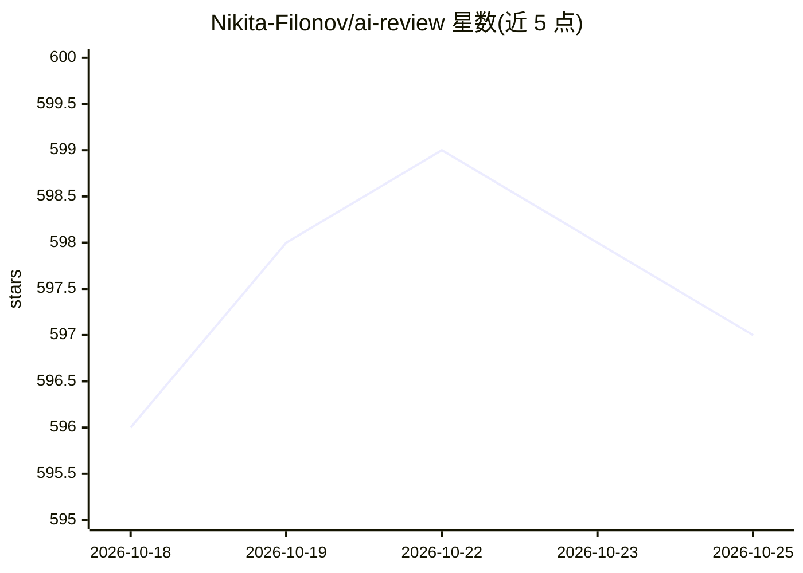

# Nikita-Filonov/ai-review

⭐ 597 · Python · Apache-2.0 · 推送 2026-10-03 · [GitHub](https://github.com/Nikita-Filonov/ai-review) · [官网](https://boosty.to/ai_review) · 个人维护

**在 CI/CD 中自动生成 AI 代码评审评论的开发者工具**

面向开发团队的 CLI 工具，在 GitHub Actions、GitLab CI 等流水线中运行，针对 Pull/Merge Request 生成行内评论、跨文件分析、总结评审及对既有评论线程的 AI 回复。支持选择 OpenAI、Claude、Gemini、Ollama、Bedrock、OpenRouter、Azure OpenAI 作为 LLM 后端，可在配置中切换。提供 Agent 模式（ReAct 式迭代、用 shell 命令探索仓库后给出评审），通过 YAML/JSON/ENV 配置；完全客户端运行，数据仅发往所配置的 LLM 端点。

## 筛选速览

| 维度 | 判定 | 备注 |
|---|---|---|
| AI 角色 | `ai-native` | 本体是模型或模型工具 |
| 许可风险 | `permissive` | Apache-2.0 |
| 部署形态 | `self-host` | docker 或自建部署 |
| 模型依赖 | local-ok | 支持本地模型 |
| 硬件要求 | — | 无带数字的原话,不猜 |
| 安装摩擦 | `low` | 无编译、无系统依赖或容器化 |
| 成熟度 | — | 结构信号不足 |

## 能力要点

- 五种评审模式：inline/context/summary 及两种回复模式，通过 CLI 子命令运行
- Agent 模式：模型先以 ls/cat/rg/git 增量探索仓库再产出评审
- 开箱支持 GitHub/GitLab/Bitbucket Cloud/Bitbucket Server/Azure DevOps/Gitea 六种 VCS
- 可配置 Ollama 本地运行时实现离线评审，数据不出基础设施

## 适用场景

- 在 CI 流水线中对 PR/MR 自动生成行内与总结评审
- 让 AI 在既有评审讨论线程中补充回复
- 使用本地 Ollama 在内网环境离线执行代码评审
- 按团队编码规范自定义 inline/context/summary 提示词模板

## 场景标签

`代码审查` · 领域:编码与开发

## 证据(README 行号)

> L42: **AI Review** is a developer tool that brings **AI-powered code review** directly into your workflow. It helps team
> L59: AI Review runs automatically in your CI/CD pipeline and posts both **inline comments**, **summary reviews**, and no

## 星数曲线

2026-10-18 596 → 2026-10-25 597（+1）

---
*卡片 v1 · prompt 1.4 · 生成 2026-10-21 · 置信度 high · 依据 README sha `11c01a3694b4` · [字段定义](../../DATASET.md)*
