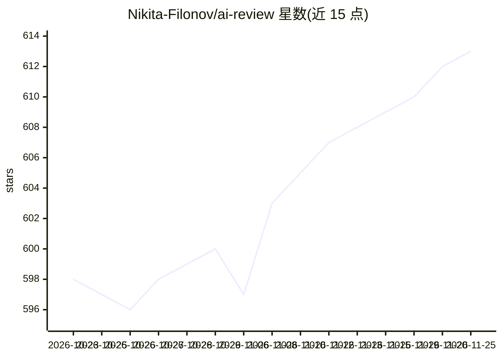

# Nikita-Filonov/ai-review

⭐ 613 · Python · Apache-2.0 · 推送 2026-11-21 · [GitHub](https://github.com/Nikita-Filonov/ai-review) · [官网](https://boosty.to/ai_review) · 个人维护

**在 CI/CD 中为 PR/MR 自动生成 AI 代码评审的工具**

面向开发团队的 AI 代码评审工具，以 Python 包与 Docker 镜像发布，在 CI/CD 流水线中运行并向 GitHub、GitLab、Bitbucket、Azure DevOps、Gitea 的合并请求发布行内评论、总结评审与回复。支持 OpenAI、Claude、Gemini、Ollama、Bedrock、OpenRouter、Azure OpenAI 七个 LLM 提供方可切换；提供 Agent 模式（ReAct 循环，模型可用 shell 命令探索仓库）；配置支持 YAML/JSON/ENV；声明完全客户端运行，不代理或存储源代码，可配置本地 Ollama 实现离线评审。

## 筛选速览

| 维度 | 判定 | 备注 |
|---|---|---|
| AI 角色 | `ai-native` | 本体是模型或模型工具 |
| 许可风险 | `permissive` | Apache-2.0 |
| 部署形态 | `self-host` | docker 或自建部署 |
| 模型依赖 | local-ok | 支持本地模型 |
| 硬件要求 | — | 无带数字的原话,不猜 |
| 安装摩擦 | `low` | 无编译、无系统依赖或容器化 |
| 成熟度 | — | 结构信号不足 |

## 能力要点

- 五种评审模式：inline、summary、context、inline-reply、summary-reply
- Agent 模式：模型用 ls/cat/rg/git 迭代探索仓库后再评审
- 七种 LLM 提供方可选，Ollama 支持本地离线评审
- 内置 GitHub Actions 与 GitLab CI/CD 集成模板

## 适用场景

- 在 GitHub/GitLab 的 PR/MR 上自动发布 AI 行内与总结评审
- 让模型先探索代码库再做跨文件问题分析
- 用自托管 Ollama 在内网环境离线运行代码评审
- 按团队编码规范自定义评审提示词与文件过滤策略

## 场景标签

`代码审查` · 领域:编码与开发

## 证据(README 行号)

> L42: **AI Review** is a developer tool that brings **AI-powered code review** directly into your workflow. It helps team
> L47: - **Multiple LLM providers** — choose between **OpenAI**, **Claude**, **Gemini**, **Ollama**, **Bedrock**,
> L59: AI Review runs automatically in your CI/CD pipeline and posts both **inline comments**, **summary reviews**, and no

## 星数曲线

2026-10-23 598 → 2026-11-25 613（+15）

---
*卡片 v1 · prompt 1.4 · 生成 2026-11-25 · 置信度 high · 依据 README sha `577e3ba2cb97` · [字段定义](../../DATASET.md)*
