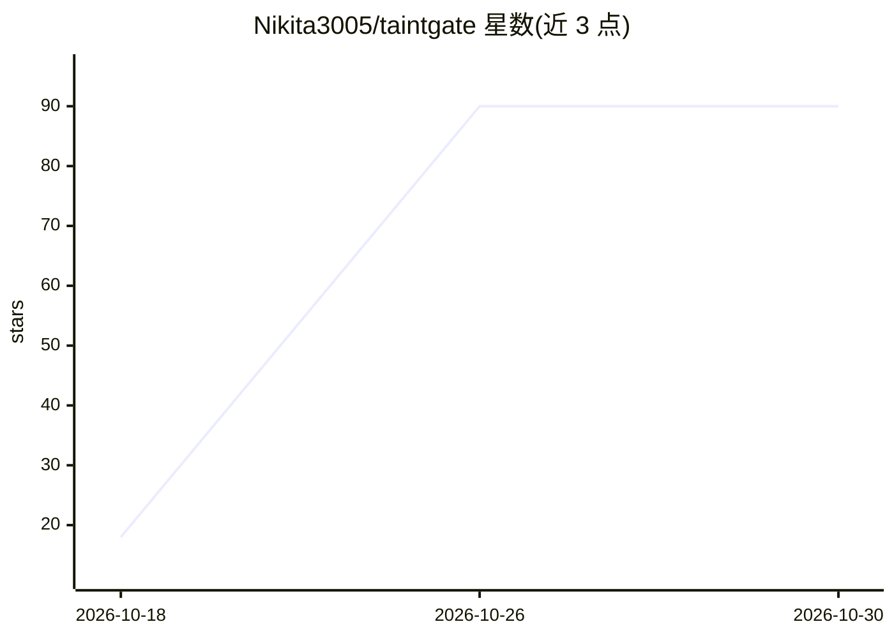

# Nikita3005/taintgate

⭐ 90 · Python · MIT · 推送 2026-08-19 · [GitHub](https://github.com/Nikita3005/taintgate) · 个人维护

**给 AI agent 开发者的运行时安全层：按数据来源对工具调用做 ALLOW/REVIEW/BLOCK 裁决**

Python 库形式的 agent 运行时防护层：在工具调用执行边界标记输入来源（用户/可信状态/不可信外部内容），结合注入启发式、密钥与 PII 检测、破坏性 shell/SQL 检测与工具元数据，由策略引擎输出确定性的 ALLOW/REVIEW/BLOCK。核心库与框架无关，提供 OpenAI Agents、LangChain/LangGraph 与 MCP 适配器；另带 12 场景的本地攻击回归套件（taintgate attack）。当前 v0.1 不提供 PyPI 发行，需经 git+https 或 GitHub Release wheel 安装；README 明确列出边界：非 OS 沙箱、不替代认证授权、绕过适配器的调用不受保护。

## 筛选速览

| 维度 | 判定 | 备注 |
|---|---|---|
| AI 角色 | `ai-ecosystem` | LLM/agent 周边工具 |
| 许可风险 | `permissive` | MIT |
| 部署形态 | `library` | 以包/库形式分发 |
| 模型依赖 | — | README 未给出锁定关系 |
| 硬件要求 | — | 无带数字的原话,不猜 |
| 安装摩擦 | `low` | 无编译、无系统依赖或容器化 |
| 成熟度 | `idea` | |

## 能力要点

- 来源标记 + 检测 + 工具元数据 + 策略的确定性三值裁决
- OpenAI Agents / LangChain / LangGraph / MCP 适配器
- 12 场景攻击回归套件（间接注入、凭证外泄、破坏性 SQL 等），支持 --json CI 输出
- 核心库无需可选框架 SDK，Python 3.10-3.13 验证

## 适用场景

- 在 agent 执行外部工具前拦截不可信数据触发的危险操作
- 对 RAG/网页/邮件内容进入的间接提示注入做回归测试
- 接入 OpenAI Agents 或 LangGraph 工具边界做运行时防护

## 场景标签

`网络安全` · 领域:学习与行业

## 证据(README 行号)

> L47: TaintGate evaluates tool calls at the execution boundary. The core idea is
> L68: The core library stays framework-independent. Adapters for OpenAI Agents,

## 星数曲线

2026-10-18 18 → 2026-10-30 90（+72）

---
*卡片 v1 · prompt 1.4 · 生成 2026-10-25 · 置信度 mid · 依据 README sha `dcc18191cf49` · [字段定义](../../DATASET.md)*
