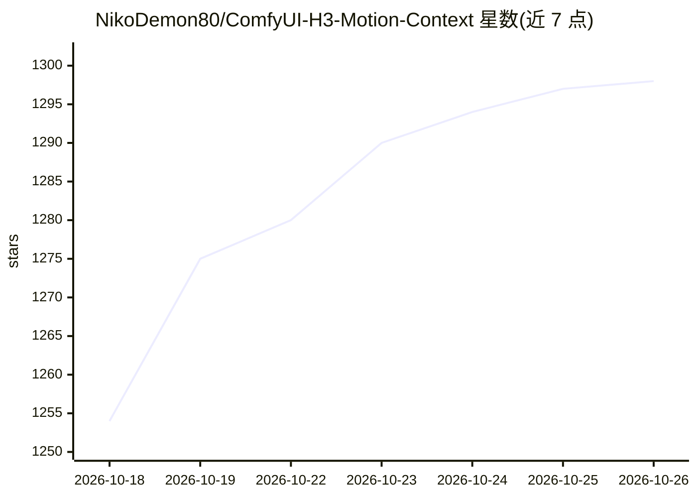

# NikoDemon80/ComfyUI-H3-Motion-Context

⭐ 1,298 · Python · GPL-3.0 · 推送 2026-10-18 · [GitHub](https://github.com/NikoDemon80/ComfyUI-H3-Motion-Context) · 个人维护

**ComfyUI 节点包：让 MiniMax H3 视频片段的运动与音频跨剪辑连续**

面向 ComfyUI 用户（需 0.34.0+，旧版兼容 0.3.1）的自定义节点集，用于将 MiniMax H3 生成的视频片段链接成链：从前一片段的 latent 直接切片出尾部帧与音频，避免像素解码/重编码往返，使后续片段延续相同运动、速度、方向与持续音轨。提供 Save/Load Latent 跨运行携带 latent、Trim 去除钉住头部、Seam Probe 检测接缝，以及 Run/Approve/Chain 循环生成控制节点。首次使用时对照 ComfyUI 代码做布局校验，不通过则拒绝运行。需手动放入 custom_nodes 目录安装。

## 筛选速览

| 维度 | 判定 | 备注 |
|---|---|---|
| AI 角色 | `ai-ecosystem` | LLM/agent 周边工具 |
| 许可风险 | `viral` | GPL-3.0 |
| 部署形态 | `None` |  |
| 模型依赖 | — | README 未给出锁定关系 |
| 硬件要求 | — | 无带数字的原话,不猜 |
| 安装摩擦 | `low` | 无编译、无系统依赖或容器化 |
| 成熟度 | — | 结构信号不足 |

## 能力要点

- 从 latent 直切前一片段尾部，避免像素往返导致的色彩漂移与画质软化
- 音频以在接缝处结束并向后回溯的窗口钉住，使音轨延续而非重新起调
- Save/Load Latent 节点通过文件跨运行携带含视频与音频双流的 H3 latent
- Chain 节点支持循环推进 Load/Save 索引连续生成多个片段

## 适用场景

- 把多个 H3 生成片段接成运动与音频都连续的长视频
- 在 ComfyUI 工作流中续接带节拍音轨的视频链
- 通过 HTTP API 远程携带 latent 文件在外部工具中管理剪辑链

## 场景标签

`视频生成` · 领域:内容生成

## 证据(README 行号)

> L53: Drop the folder in `ComfyUI/custom_nodes/` and restart. At startup you'll
> L79: MiniMaxH3ImageToVideo / MiniMaxH3ReferenceToVideo (or the t2v path)

## 星数曲线

2026-10-18 1,254 → 2026-10-26 1,298（+44）

---
*卡片 v1 · prompt 1.4 · 生成 2026-10-21 · 置信度 high · 依据 README sha `ea02745eaf54` · [字段定义](../../DATASET.md)*
