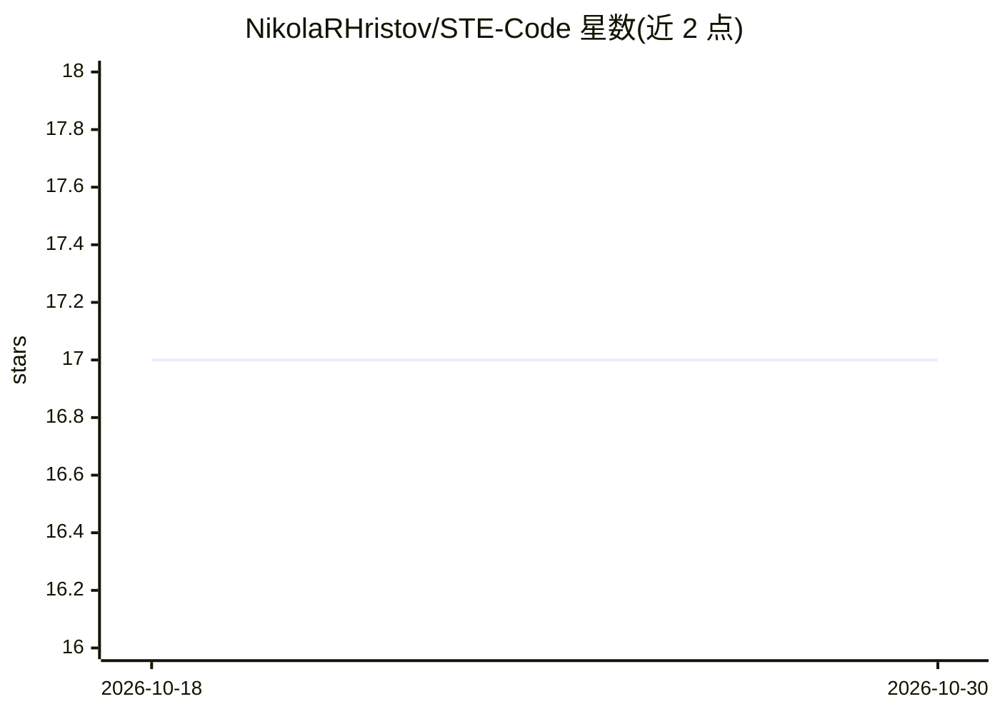

# NikolaRHristov/STE-Code

⭐ 17 · Python · NOASSERTION · 推送 2026-09-11 · [GitHub](https://github.com/NikolaRHristov/STE-Code) · [官网](https://github.com/NikolaRHristov/STE-Code) · 个人维护

**将 ASD-STE100 受控英语标准适配到代码文档的分层 prompt 工件集**

把航空业受控语言标准 ASD-STE100 提取、精炼并适配到软件领域，产出 8 个严格度递增的纯文本 system-prompt 层级文件（约 1.2K 至 133.8K token），用户将文件载入任意接受 system prompt 的模型，模型即按 54 条写作规则、批准词表与同义词表重写 docstring、提交信息、API 文档等技术文档。构建管线为五阶段（LLM 工作者与确定性脚本混合），附 59 项测试的基准套件与 Make 检查门。不复制原标准文本，仅适配规则原则。

## 筛选速览

| 维度 | 判定 | 备注 |
|---|---|---|
| AI 角色 | `ai-knowledge` | 知识聚合/清单类 |
| 许可风险 | `permissive` | NOASSERTION |
| 部署形态 | `None` |  |
| 模型依赖 | local-ok | 支持本地模型 |
| 硬件要求 | — | 无带数字的原话,不猜 |
| 安装摩擦 | `low` | 无编译、无系统依赖或容器化 |
| 成熟度 | — | 结构信号不足 |

## 能力要点

- 8 个层级（-2 至 5）的 system-prompt 工件，严格度与 token 成本递增
- 54 条规则、9 个章节，含面向代码范式的领域适配
- 五阶段构建管线（提取→精炼→合并→适配→工件），混合 LLM 与确定性步骤
- 59 项测试、14 类别的基准套件，对比有无工件的同模型表现

## 适用场景

- 让 LLM 把项目 docstring、提交信息、API 文档改写为无歧义受控英语
- 按上下文窗口预算选择合适严格度的标准层级加载
- 为团队引入可执行的文档写作规范并跑基准验证效果

## 场景标签

`提示工程` · 领域:Agent 开发

## 证据(README 行号)

> L13: > STE-Code applies that idea to code documentation: 54 writing rules in 9
> L18: > _You do not have to read the standard yourself. Load the level artifacts into
> L24: Each level is one plain-text file. Copy the file into the system-prompt field of

## 星数曲线

2026-10-18 17 → 2026-10-30 17（+0）

---
*卡片 v1 · prompt 1.4 · 生成 2026-10-30 · 置信度 high · 依据 README sha `2b3e3f744cdd` · [字段定义](../../DATASET.md)*
