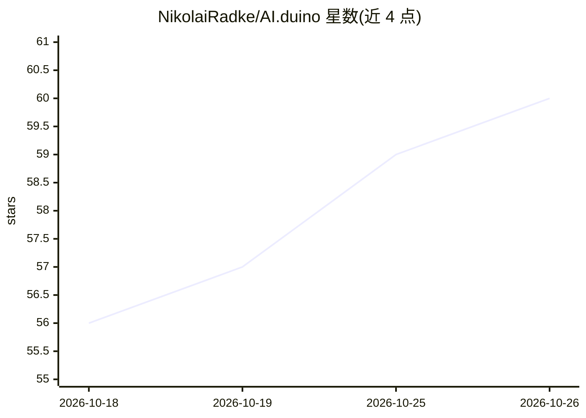

# NikolaiRadke/AI.duino

⭐ 60 · JavaScript · Apache-2.0 · 推送 2026-10-13 · [GitHub](https://github.com/NikolaiRadke/AI.duino) · [官网](http://www.monstermaker.de) · 个人维护

**Arduino IDE 的 AI 编程助手插件，接入多家云端与本地模型**

面向 Arduino IDE 2.X（也可用于 VS Code）的 AI 助手插件，通过 API 接入 Claude、ChatGPT、Gemini、Mistral、Groq、OpenRouter、Hugging Face 及本地 LM Studio、Ollama 等提供方。功能包括代码优化与解释、自动注释、编译错误分析、AI 对话、内联补全、自定义 Agent，以及 V2.6.0 起的 Agentic Coding（AI 直接读写项目文件并通过编译验证修改）。安装通过 VSIX 包与各平台脚本完成，使用云端模型需自备 API key，本地 HTTP 提供方可自动检测。

## 筛选速览

| 维度 | 判定 | 备注 |
|---|---|---|
| AI 角色 | `ai-native` | 本体是模型或模型工具 |
| 许可风险 | `permissive` | Apache-2.0 |
| 部署形态 | `None` |  |
| 模型依赖 | local-ok | 支持本地模型 |
| 硬件要求 | — | 无带数字的原话,不猜 |
| 安装摩擦 | `low` | 无编译、无系统依赖或容器化 |
| 成熟度 | — | 结构信号不足 |

## 能力要点

- 代码优化、错误分析、内联补全等 IDE 内 AI 功能
- V2.6.0 起 Agentic Coding：AI 直接读写项目文件并自主编译修复
- 支持 35 种界面语言（语言包由 AI 生成，可自行添加）
- 接入 Claude Code、Codex CLI、Gemini CLI、Ollama 等进程提供方

## 适用场景

- 在 Arduino IDE 内向 AI 解释或优化我的代码
- 让 AI 分析编译错误和串口监视器输出
- 通过对话让 AI 直接修改项目文件并自动验证编译
- 在 VS Code 中使用同一套 Arduino AI 助手

## 场景标签

`编码 Agent` `代码生成` · 领域:编码与开发

## 证据(README 行号)

> L4: AI.duino integrates the API providers **Claude, ChatGPT, Gemini, Mistral, Perplexity and Cohere, Croq**, aggregator 
> L6: Since **V2.6.0**, AI.duino supports full Agentic Coding: Unlike traditional AI chat, Agentic Coding allows the AI to
> L46: ### AI Chat

## 星数曲线

2026-10-18 56 → 2026-10-26 60（+4）

---
*卡片 v1 · prompt 1.4 · 生成 2026-10-24 · 置信度 high · 依据 README sha `68e8eb969d48` · [字段定义](../../DATASET.md)*
