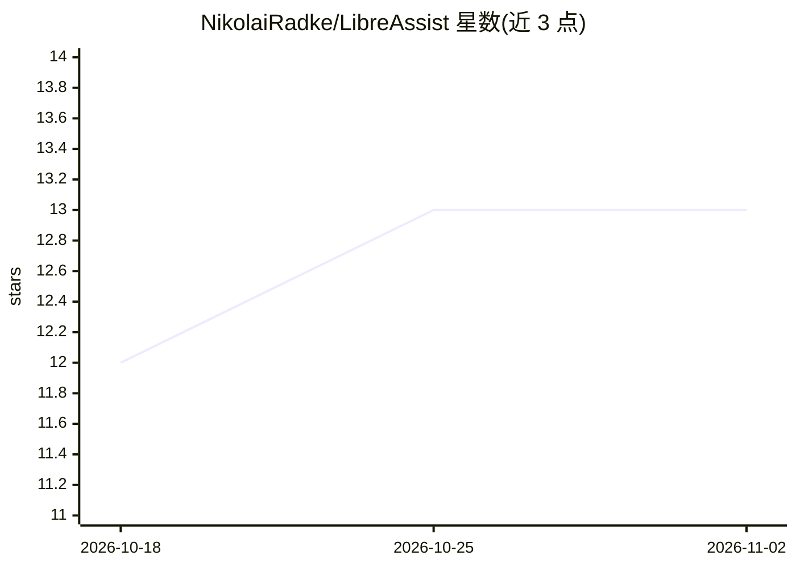

# NikolaiRadke/LibreAssist

⭐ 13 · Python · Apache-2.0 · 推送 2026-10-31 · [GitHub](https://github.com/NikolaiRadke/LibreAssist) · 个人维护

**LibreOffice 写作助手扩展：AI 通过 CLI 直接编辑文档**

LibreOffice 扩展（.oxt 安装包），将 AI 写作辅助嵌入 Writer 侧边栏：通过 Claude Code CLI、Codex CLI、Mistral Vibe CLI 等命令行工具实现 Agentic Writing，AI 可直接操作文档内容与设计元素。支持修订追踪、撤销/重做、按文档保存的会话历史与自定义指令，提供 en/de/fr/it/es 五种界面语言。需 LibreOffice、Python 3.8+ 及至少一个 CLI provider；Gemini CLI 与 Groq Code 经测试无法编辑 .odt 文件，Mistral Vibe 为实验性支持（ODT 后处理可能损坏文件）。

## 筛选速览

| 维度 | 判定 | 备注 |
|---|---|---|
| AI 角色 | `ai-native` | 本体是模型或模型工具 |
| 许可风险 | `permissive` | Apache-2.0 |
| 部署形态 | `desktop` | 安装包/桌面程序 |
| 模型依赖 | locked-api |  |
| 硬件要求 | — | 无带数字的原话,不猜 |
| 安装摩擦 | `low` | 无编译、无系统依赖或容器化 |
| 成熟度 | `idea` | |

## 能力要点

- AI 通过 CLI 直接写入文档，含设计元素
- 修订追踪（opt-in）与撤销/重做备份系统
- 多 provider 前缀切换（claude/codex/mistral）
- 按文档持久化聊天历史与会话上下文

## 适用场景

- 在 Writer 中让 AI 起草、改写或修正文档而不必复制粘贴
- 通过修订模式审阅 AI 修改并按需撤销
- 多语言用户在写作中获得 AI 辅助

## 场景标签

`AI 写作` `AI 助手` · 领域:对话与助手

## 证据(README 行号)

> L4: **AI-powered Agentic Writing Assistant for LibreOffice**
> L16: - 🤖 **Multi-Provider Support** - Works with Claude Code CLI, Codex CLI and Mistral Vibe CLI

## 星数曲线

2026-10-18 12 → 2026-11-02 13（+1）

---
*卡片 v1 · prompt 1.4 · 生成 2026-10-31 · 置信度 mid · 依据 README sha `11454157a5fa` · [字段定义](../../DATASET.md)*
