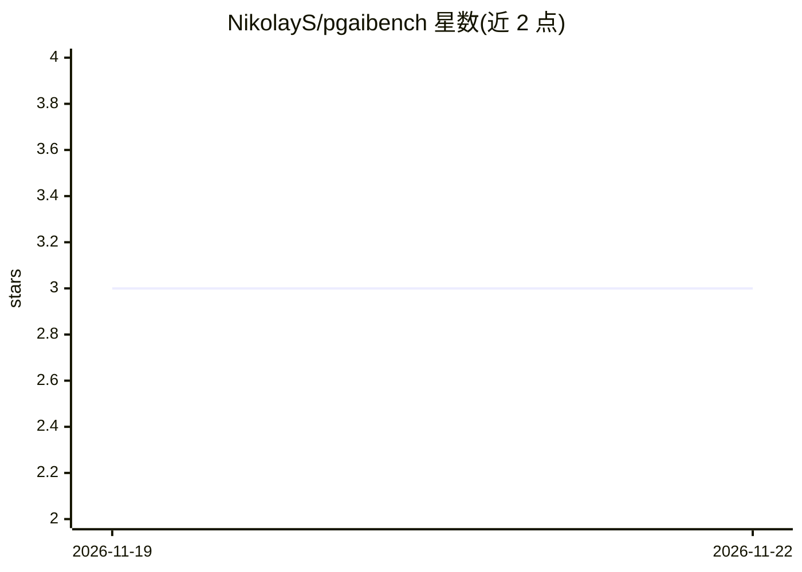

# NikolayS/pgaibench

⭐ 3 · TypeScript · Apache-2.0 · 推送 2026-11-21 · [GitHub](https://github.com/NikolayS/pgaibench) · [官网](https://pgaibench.dev) · 组织维护

**评测 LLM 能否安全变更生产 Postgres 的基准测试**

PGAIBench 是一个基准测试项目：给定加列、改配置、修数据等带陷阱的数据库变更任务，让被测模型写出变更请求或升级人工，随后在带主备和负载的 Postgres 18 实验室环境中实际执行并测量危害（锁等待、p99 延迟、复制延迟等），按固定规则与 AI 读者分类打分。遵循 Analyst/Auditor/Actor 的 AAA 设计，v0.1 仅测 Analyst 角色，不支持工具调用，含 3 个不公开的 held-out 场景。发布预注册文档与排行榜，面向 Postgres 运维与 LLM 评测人群。

## 筛选速览

| 维度 | 判定 | 备注 |
|---|---|---|
| AI 角色 | `ai-ecosystem` | LLM/agent 周边工具 |
| 许可风险 | `permissive` | Apache-2.0 |
| 部署形态 | `None` |  |
| 模型依赖 | — | README 未给出锁定关系 |
| 硬件要求 | — | 无带数字的原话,不猜 |
| 安装摩擦 | `low` | 无编译、无系统依赖或容器化 |
| 成熟度 | `idea` | |

## 能力要点

- 带陷阱的变更场景 + 克隆彩排 + 负载实验室执行的危害测量
- AAA 设计（Analyst/Auditor/Actor），v0.1 测 Analyst 轨道
- 预注册方法、held-out 私有场景防训练污染、canary 标记
- 按证据分级（harm observed / success key / stopped at rehearsal / pattern only）报告

## 适用场景

- 评估模型在数据库变更场景下的风险识别与拒绝能力
- 复现或扩展 Postgres 运维 LLM 评测方法
- 对比不同模型在相同任务与推理档位下的表现

## 场景标签

`模型评测` · 领域:评测与运维

## 证据(README 行号)

> L11: PGAIBench checks whether AI models can change a production Postgres
> L34: - Role under test: Analyst (the author of the change). The model writes
> L73: PGAIBench follows the AAA design for automated database operations: an

## 星数曲线

2026-11-19 3 → 2026-11-22 3（+0）

---
*卡片 v1 · prompt 1.4 · 生成 2026-11-22 · 置信度 high · 依据 README sha `deee8a62e18f` · [字段定义](../../DATASET.md)*
