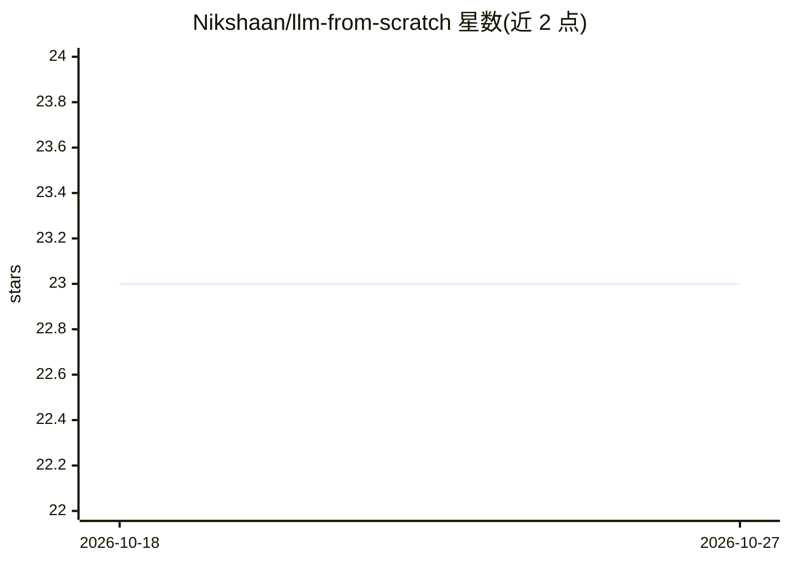

# Nikshaan/llm-from-scratch

⭐ 23 · Python · 推送 2026-01-22 · [GitHub](https://github.com/Nikshaan/llm-from-scratch) · 个人维护

**用 PyTorch 从零实现 GPT 并预训练/微调的学习型代码库**

Sebastian Raschka《Build a LLM from Scratch》一书的配套实现：用 PyTorch 从零编写自定义分词器、自注意力/因果注意力/多头注意力、GPT 模型结构与训练循环，含 temperature 与 top-k 采样的文本生成。微调部分提供两条路径：SMS 垃圾短信分类微调与 Alpaca 格式指令微调。源码按书中第 2-7 章组织，提供 Colab notebook、requirements.txt 与逐脚本运行命令，面向学习 LLM 内部机制的开发者与学习者。

## 筛选速览

| 维度 | 判定 | 备注 |
|---|---|---|
| AI 角色 | `ai-native` | 本体是模型或模型工具 |
| 许可风险 | `none` | — |
| 部署形态 | `library` | 以包/库形式分发 |
| 模型依赖 | — | README 未给出锁定关系 |
| 硬件要求 | — | 无带数字的原话,不猜 |
| 安装摩擦 | `low` | 无编译、无系统依赖或容器化 |
| 成熟度 | — | 结构信号不足 |

## 能力要点

- 从零实现分词、注意力机制与完整 GPT 架构
- temperature 与 top-k 采样的文本生成
- 分类微调（SMS 垃圾检测）与 Alpaca 式指令微调
- 源码结构按原书第 2-7 章对应组织

## 适用场景

- 跟随书籍章节逐步实现并理解 GPT 内部机制
- 在自己的数据集上跑通预训练与指令微调流程
- 把生成式 GPT 改造为文本分类模型

## 场景标签

`微调` `模型训练` `教程课程` · 领域:学习与行业

## 证据(README 行号)

> L3: An implementation of a GPT style Large Language Model built from scratch using PyTorch. This repository contains the
> L35: - **GPTModel**: Full implementation of GPT with configurable layers
> L45: - **generate**: Text generation with temperature and top-k sampling

## 星数曲线

2026-10-18 23 → 2026-10-27 23（+0）

---
*卡片 v1 · prompt 1.4 · 生成 2026-10-27 · 置信度 high · 依据 README sha `dc502582f170` · [字段定义](../../DATASET.md)*
