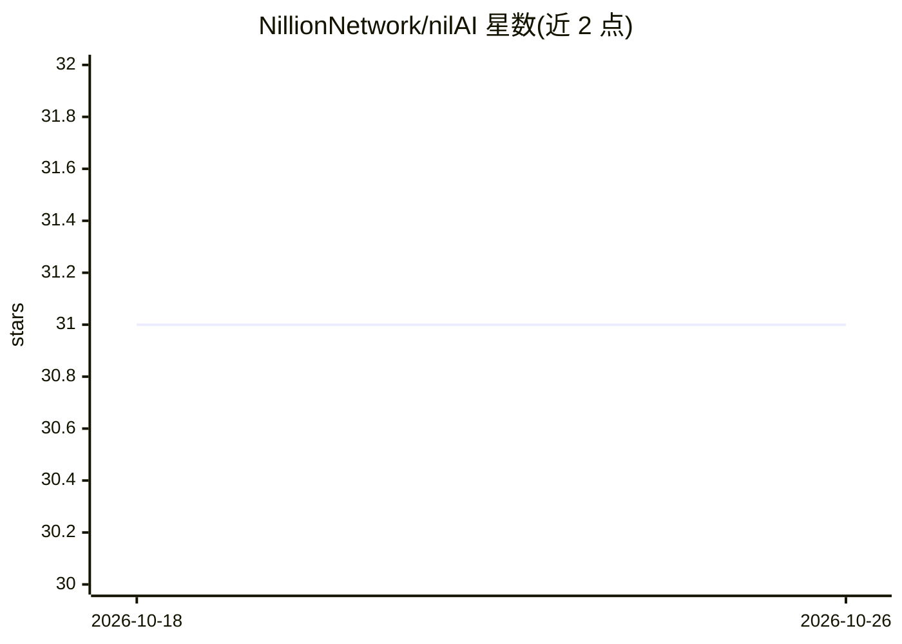

# NillionNetwork/nilAI

⭐ 31 · Python · MIT · 推送 2026-04-16 · [GitHub](https://github.com/NillionNetwork/nilAI) · [官网](https://docs.nillion.com/build/private-llms/quickstart) · 组织维护

**在 TEE 可信执行环境中部署管理多模型的推理服务平台**

面向 Confidential VM / TEE 环境的 AI 模型部署与管理平台：通过统一 API 接口访问多个 AI 模型，提供用户管理与模型生命周期处理（模型自注册到 Redis Discovery 数据库、断连自动移除）。后端基于 vLLM 构建 Docker 镜像运行 Llama 等模型，支持 CPU-only 与 GPU 的 Docker Compose 部署，附带 docker-composer.py 脚本管理多 compose 文件与镜像替换；访问部分模型需 Hugging Face API Token。

## 筛选速览

| 维度 | 判定 | 备注 |
|---|---|---|
| AI 角色 | `ai-ecosystem` | LLM/agent 周边工具 |
| 许可风险 | `permissive` | MIT |
| 部署形态 | `self-host` | docker 或自建部署 |
| 模型依赖 | local-ok | 支持本地模型 |
| 硬件要求 | `cpu-ok` | |
| 安装摩擦 | `low` | 无编译、无系统依赖或容器化 |
| 成熟度 | — | 结构信号不足 |

## 能力要点

- 在 TEE/Confidential VM 上部署并统一 API 访问多个模型
- 模型自注册 Redis Discovery、断连自动摘除的生命周期管理
- Docker Compose 支持 CPU-only 与 GPU（Llama 1B/3B/8B）部署
- docker-composer.py 脚本支持镜像替换与多环境配置生成

## 适用场景

- 在可信执行环境中部署 LLM 推理服务
- 通过统一 API 管理多个模型并控制用户权限
- 无 GPU 环境下以 CPU-only 配置测试部署

## 场景标签

`推理引擎` · 领域:训练与推理

## 证据(README 行号)

> L4: nilAI is a platform designed to run on Confidential VMs with Trusted Execution Environments (TEEs). It ensures secur
> L173: ### vLLM for Local Execution on macOS

## 星数曲线

2026-10-18 31 → 2026-10-26 31（+0）

---
*卡片 v1 · prompt 1.4 · 生成 2026-10-26 · 置信度 high · 依据 README sha `b50f8ff67015` · [字段定义](../../DATASET.md)*
