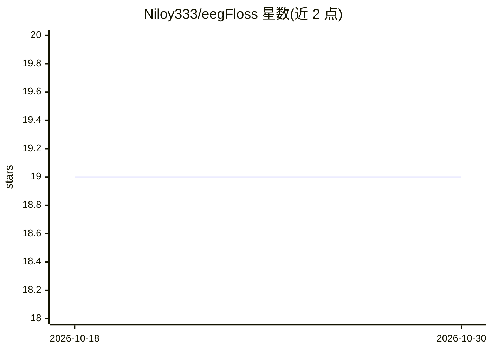

# Niloy333/eegFloss

⭐ 19 · Python · MIT · 推送 2026-09-11 · [GitHub](https://github.com/Niloy333/eegFloss) · 组织维护

**自动识别睡眠 EEG 伪迹并评估数据可用性的 Python 包**

面向睡眠研究者的 Python 包，核心是 eegUsability 机器学习模型：读取 EDF/BDF 格式的睡眠 EEG，检测高噪声、尖峰噪声、M 形噪声等伪迹片段，按多数规则与给定睡眠分期合并生成伪迹剔除后的分期，并计算睡眠统计量；配套 eegMobility 模型基于加速度计数据自动识别 Time-in-Bed。模型基于 Zmax 头环 15 名受试 127 夜人工标注数据训练，可应用于符合 AASM 标准的其他设备数据。不内置自动睡眠分期器；TIB 检测仅在 Zmax 数据上验证。以脚本集合形式在 conda 环境中运行。

## 筛选速览

| 维度 | 判定 | 备注 |
|---|---|---|
| AI 角色 | `ai-native` | 本体是模型或模型工具 |
| 许可风险 | `permissive` | MIT |
| 部署形态 | `library` | 以包/库形式分发 |
| 模型依赖 | — | README 未给出锁定关系 |
| 硬件要求 | — | 无带数字的原话,不猜 |
| 安装摩擦 | `low` | 无编译、无系统依赖或容器化 |
| 成熟度 | — | 结构信号不足 |

## 能力要点

- eegUsability ML 模型检测多类伪迹并输出数据可用性评分
- 结合用户提供的睡眠分期生成伪迹剔除后的分期与统计量
- eegMobility 模型从加速度计数据自动检测 Time-in-Bed
- 提供 4 个版本的 eegUsability 模型（F1 84.87–89.4%，8 小时数据处理约 3–36 秒）

## 适用场景

- 清洗可穿戴设备或 PSG 采集的睡眠 EEG 伪迹
- 自动评估睡眠数据是否适用于自动分期模型
- 从 Zmax 加速度计数据自动识别在床时间并计算睡眠统计

## 场景标签

 · 领域:睡眠研究/生物医学信号处理

## 证据(README 行号)

> L22: eegFloss addresses this challenge with *eegUsability*—a machine learning (ML) model designed to detect artifact-con
> L60: - Detects artifacts in sleep EEG data using a chosen eegUsability model.
> L136: eegUsability detects the following artifacts in raw sleep EEG data:

## 星数曲线

2026-10-18 19 → 2026-10-30 19（+0）

---
*卡片 v1 · prompt 1.4 · 生成 2026-10-28 · 置信度 mid · 依据 README sha `867e7df0d0e6` · [字段定义](../../DATASET.md)*
