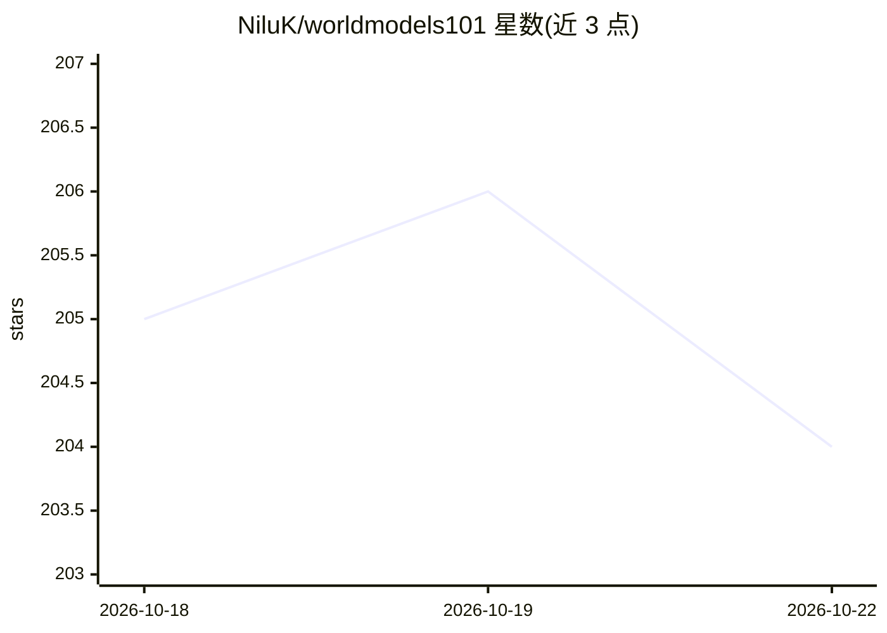

# NiluK/worldmodels101

⭐ 204 · TypeScript · CC-BY-SA-4.0 · 推送 2026-08-24 · [GitHub](https://github.com/NiluK/worldmodels101) · [官网](https://worldmodels101.com) · 个人维护

**世界模型免费互动课程：9 章讲解预测、潜空间与规划**

面向学习者的免费互动课程，用 9 个视觉章节讲解 AI 世界模型的五类定义与工作机制，覆盖预测与学习的关系、潜空间、动力学模型、想象内学习、JEPA、视频模型与失效模式。每章含可操作的交互演示，声明所用定义、引用原始论文并附小测验，可在线阅读或导出 PDF。仓库提供 pnpm 脚本在本地运行课程站点与生成 PDF。

## 筛选速览

| 维度 | 判定 | 备注 |
|---|---|---|
| AI 角色 | `ai-knowledge` | 知识聚合/清单类 |
| 许可风险 | `viral` | CC-BY-SA-4.0 |
| 部署形态 | `library` | 以包/库形式分发 |
| 模型依赖 | — | README 未给出锁定关系 |
| 硬件要求 | — | 无带数字的原话,不猜 |
| 安装摩擦 | `low` | 无编译、无系统依赖或容器化 |
| 成熟度 | — | 结构信号不足 |

## 能力要点

- 五类世界模型定义（渲染器/模拟器/控制器/表征/隐式模型）的梳理框架
- 每章含交互演示、论文引用与小测验
- 全部章节支持打印布局与 PDF 导出
- 视频来源经 oEmbed 校验，不可核实的主张标注出处

## 适用场景

- 系统学习世界模型的概念分类与核心机制
- 按章节理解 JEPA、潜空间、动力学模型等主题
- 离线阅读或打印课程材料

## 场景标签

`教程课程` · 领域:学习与行业

## 证据(README 行号)

> L3: A free, interactive course on how machines learn to predict, simulate, and plan.
> L13: Nine chapters. About two hours. No signup. Every chapter has an interactive and

## 星数曲线

2026-10-18 205 → 2026-10-22 204（-1）

---
*卡片 v1 · prompt 1.4 · 生成 2026-10-22 · 置信度 mid · 依据 README sha `b647eecb6138` · [字段定义](../../DATASET.md)*
