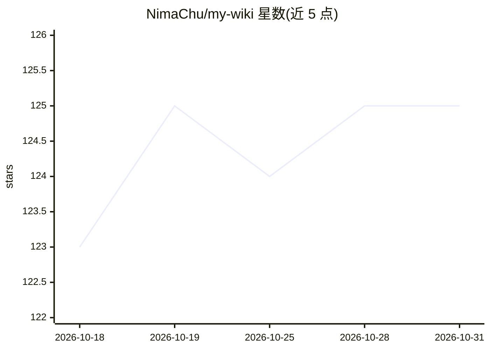

# NimaChu/my-wiki

⭐ 125 · JavaScript · MIT · 推送 2026-10-15 · [GitHub](https://github.com/NimaChu/my-wiki) · [官网](https://www.npmjs.com/package/my-wiki-skill) · 个人维护 · 中文 README

**本地优先的 AI 知识管理应用：Agent 整理资料为可追溯知识库**

面向个人知识管理的本地优先项目：AI Agent 负责知识完整生命周期——保存 Reference 与原始文件、提取正文、蒸馏原子 Concept、建立关系与证据链接、回答问题（Viki）并维护知识健康。知识以 Markdown 与原件存于本地目录，默认不依赖云数据库、向量数据库或付费 API。项目主体为 CLI 与网页知识宇宙前端，另带可选 Skill 适配层，可安装到 Codex、Claude Code、OpenCode 等客户端调用。支持知识星系导出为 OKF v0.2 兼容的 .mywiki 知识包分享。文档提取采用 MinerU/Docling 等解析器并配逐页质量门禁；需 Node.js 18+ 与已登录的本地 Agent 客户端。

## 筛选速览

| 维度 | 判定 | 备注 |
|---|---|---|
| AI 角色 | `ai-native` | 本体是模型或模型工具 |
| 许可风险 | `permissive` | MIT |
| 部署形态 | `library` | 以包/库形式分发 |
| 模型依赖 | — | README 未给出锁定关系 |
| 硬件要求 | — | 无带数字的原话,不猜 |
| 安装摩擦 | `low` | 无编译、无系统依赖或容器化 |
| 成熟度 | — | 结构信号不足 |

## 能力要点

- Agent 驱动的入库-蒸馏-链接-维护知识工作流，结论回链 Reference 证据
- 交互式知识宇宙/知识星系/Concept 星球可视化网页前端
- 知识星系可导出为 OKF v0.2 审计的 .mywiki 可移植知识包
- 可单独安装的 Agent Skill，适配 Claude Code、Codex、OpenCode 等客户端

## 适用场景

- 让本地 Agent 把网页、PDF、扫描件、Office 文档整理成可追溯的知识库
- 通过知识宇宙网页浏览、维护和问答自己的知识
- 把成体系的知识星系导出分享给他人继续维护

## 场景标签

`知识库管理` `文档解析` `知识图谱` · 领域:知识与检索

## 证据(README 行号)

> L12: **My Wiki 是一个可直接交给 AI Agent 使用的本地优先知识管理项目。项目主体提供 CLI、可视化知识宇宙、知识维护和 Viki 问答；仓库内另带一个可单独安装的轻量 Skill，用于让其他工作区中的 Agent 调
> L20: My Wiki 让本地 AI Agent 负责知识的完整生命周期：保存 Reference 与 original，提取可读正文，蒸馏原子 Concept，建立关系与证据链接，回答问题，维护知识健康，并通过网页把知识呈现为可以探索和
> L109: - Viki 可选 OpenCode Server、DeepSeek API 或腾讯云 Token Plan 内置只读 Agent，共用真实流式通道；其他 CLI 保持完整回答模式。各 API Key 独立保存在服务端，修复/蒸

## 星数曲线

2026-10-18 123 → 2026-10-31 125（+2）

---
*卡片 v1 · prompt 1.4 · 生成 2026-10-23 · 置信度 high · 依据 README sha `4ade20390c0a` · [字段定义](../../DATASET.md)*
