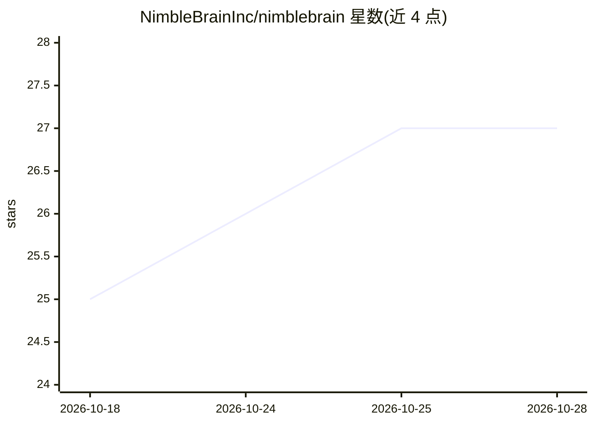

# NimbleBrainInc/nimblebrain

⭐ 28 · TypeScript · NOASSERTION · 推送 2026-10-28 · [GitHub](https://github.com/NimbleBrainInc/nimblebrain) · [官网](https://nimblebrain.ai) · 组织维护

**自托管的 MCP 应用与 agent 任务运行平台**

面向自部署用户的 MCP Apps 与 agent 自动化平台：既作为 MCP 客户端连接远程 connector，也将自身聚合的工具集通过 Streamable HTTP 暴露为 MCP 服务器。核心机制包括 ToolRegistry 统一工具命名空间、YAML frontmatter 技能文件注入系统提示并按任务限定工具访问、工作区级隔离（连接器/会话数据不跨工作区）、按需或 cron 定时运行 agent、侧边栏交互式 UI 与 agent-UI 数据同步。以 GHCR 容器镜像分发，也可用 Bun 从源码运行；模型默认 anthropic:claude-sonnet-4-6，支持多提供商模型槽位。运行需要 instance.json 身份配置（dev 模式可自动写入）。

## 筛选速览

| 维度 | 判定 | 备注 |
|---|---|---|
| AI 角色 | `ai-ecosystem` | LLM/agent 周边工具 |
| 许可风险 | `none` | NOASSERTION |
| 部署形态 | `self-host` | docker 或自建部署 |
| 模型依赖 | locked-api |  |
| 硬件要求 | — | 无带数字的原话,不猜 |
| 安装摩擦 | `low` | 无编译、无系统依赖或容器化 |
| 成熟度 | — | 结构信号不足 |

## 能力要点

- 既是 MCP 客户端也是 MCP 服务器（Streamable HTTP，按工作区端点）
- ToolRegistry 聚合所有已连接 MCP 服务器的工具为单一命名空间
- Skills（markdown+YAML frontmatter）注入系统提示并限定工具访问，两阶段触发匹配
- 实例级/工作区级双配置文件实现工作区隔离，连接器与数据不跨工作区

## 适用场景

- 自托管运行带交互式 UI 的 MCP 应用与 agent 自动化
- 用 cron 定时或按需调度 agent 任务
- 将多个 MCP 连接器的工具聚合并对外暴露为 MCP 服务器
- 多工作区隔离管理不同的连接器组合与数据

## 场景标签

`Agent 框架` `工作流自动化` · 领域:Agent 开发

## 证据(README 行号)

> L8: A self-hosted platform for MCP Apps and agent tasks. Install an MCP connector and you get more than tools — you get 
> L93: NimbleBrain is both an MCP **client** (connecting to remote connectors over HTTP/SSE, and to the platform's own cap
> L145: No connectors are installed by default. Platform apps (conversations, files, usage, tasks, and the rest) are built

## 星数曲线

2026-10-18 25 → 2026-10-28 27（+2）

---
*卡片 v1 · prompt 1.4 · 生成 2026-10-26 · 置信度 high · 依据 README sha `4639056dbdad` · [字段定义](../../DATASET.md)*
