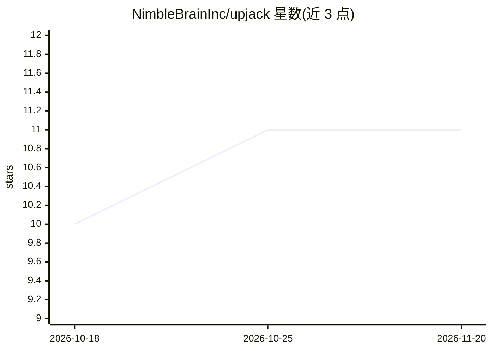

# NimbleBrainInc/upjack

⭐ 11 · Python · Apache-2.0 · 推送 2026-04-17 · [GitHub](https://github.com/NimbleBrainInc/upjack) · [官网](https://upjack.dev) · 组织维护

**声明式 AI 原生应用框架：两个文件生成实体管理与 MCP 服务器**

面向开发者的 Python/TypeScript 框架：写 JSON Schema 定义实体、写 Markdown 编写领域知识，自动生成每实体 6 个 MCP 工具（CRUD+搜索）、写入校验、类型前缀 ULID、全文检索与 JSON 文件存储，并以 MCPB 包格式打包分发。内部基于 FastMCP 生成 MCP 服务器，经 stdio 与任意 MCP 客户端连接。快速路径提供 App Builder 技能由 agent 代为生成应用；要求 Python 3.13+ 或 Node 18+。

## 筛选速览

| 维度 | 判定 | 备注 |
|---|---|---|
| AI 角色 | `ai-ecosystem` | LLM/agent 周边工具 |
| 许可风险 | `permissive` | Apache-2.0 |
| 部署形态 | `library` | 以包/库形式分发 |
| 模型依赖 | — | README 未给出锁定关系 |
| 硬件要求 | — | 无带数字的原话,不猜 |
| 安装摩擦 | `low` | 无编译、无系统依赖或容器化 |
| 成熟度 | — | 结构信号不足 |

## 能力要点

- 每实体自动生成 6 个 MCP 工具（create/get/update/list/search/delete）
- JSON Schema 写入时校验 + Markdown 技能作为 agent 资源（upjack://skills/*）
- 应用以 MCPB 包格式打包，支持 mpak 分发
- Python 与 TypeScript 双实现，同一 API

## 适用场景

- 让 Claude 等 agent 直接操作 CRM、任务跟踪、研究笔记等业务数据
- 不写 API 代码快速搭建带校验与检索的领域应用
- 通过 hooks 与 schedules 实现定时评分、变更触发的自动化

## 场景标签

 · 领域:AI 应用开发框架/MCP

## 证据(README 行号)

> L11: **Build AI-powered apps by describing your domain, not writing code.**
> L13: Write a JSON Schema for your data. Write Markdown for your domain expertise. Get entity management, validation, sea
> L37: |MCP|Model Context Protocol — a standard that lets AI agents call tools and read resources. Upjack can expose your 

## 星数曲线

2026-10-18 10 → 2026-11-20 11（+1）

---
*卡片 v1 · prompt 1.4 · 生成 2026-11-19 · 置信度 high · 依据 README sha `f0dac86d0e3c` · [字段定义](../../DATASET.md)*
