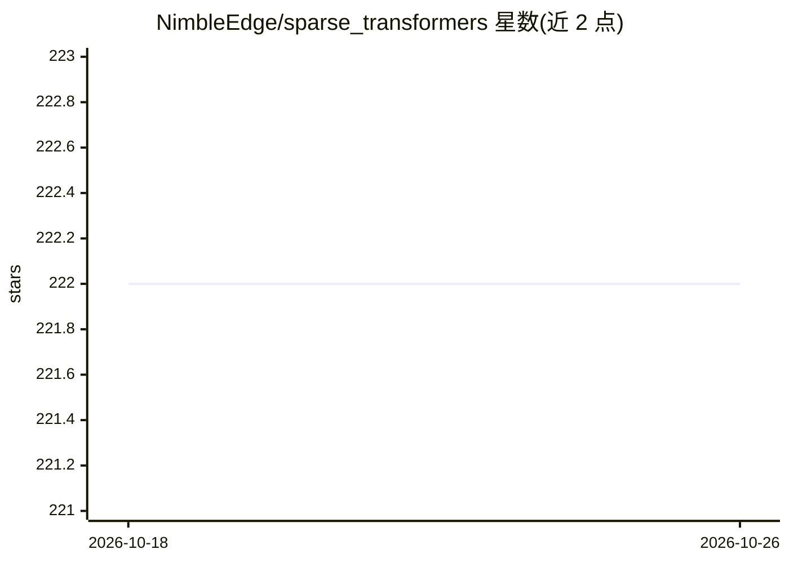

# NimbleEdge/sparse_transformers

⭐ 222 · Python · Apache-2.0 · 推送 2026-03-25 · [GitHub](https://github.com/NimbleEdge/sparse_transformers) · 组织维护

**面向 LLM 推理的稀疏化 C++ 内核：加速 MLP 层计算**

基于 Deja Vu 与 Apple LLM in a Flash 思路实现的 Transformer 稀疏推理项目：通过低秩权重激活预测稀疏掩码，用 C++/Torch 扩展实现稀疏矩阵乘法并融合 MLP 层的上/下投影，配合差分权重缓存（配对替换算法）动态更新活跃权重。CPU fp16/fp32 内核已实现，CUDA 内核与 int8 等仍在路线图中（当前 CUDA 为 0.86x，标注 WIP）。面向研究 LLM 推理优化的开发者，需从源码克隆并编译 C++ 扩展。

## 筛选速览

| 维度 | 判定 | 备注 |
|---|---|---|
| AI 角色 | `ai-ecosystem` | LLM/agent 周边工具 |
| 许可风险 | `permissive` | Apache-2.0 |
| 部署形态 | `library` | 以包/库形式分发 |
| 模型依赖 | — | README 未给出锁定关系 |
| 硬件要求 | — | 无带数字的原话,不猜 |
| 安装摩擦 | `medium` | 含编译或系统依赖之一 |
| 成熟度 | `idea` | |

## 能力要点

- 稀疏乘法融合 MLP 上/下投影（低秩权重激活预测稀疏掩码）
- 差分权重缓存与配对替换算法，缓存更新提速 6.7×
- CPU fp16/fp32 Torch 内核与 OpenMP 并行化
- 在 LLaMA 3.2 3B 上报告 TTFT/吞吐 1.5-1.8× 提升、内存降 26.4%

## 适用场景

- 加速 CPU 上 LLaMA 类模型的推理与吞吐
- 研究动态稀疏与差分权重缓存技术
- 降低大模型推理的内存占用

## 场景标签

`推理引擎` · 领域:训练与推理

## 证据(README 行号)

> L7: The project implements sparse multiplication and fuses up/down projections in the MLP layers through low rank weight
> L26: - [x] Torch CPU kernels for fp16, fp32
> L28: - [ ] CUDA kernels for Sparse Inferencing

## 星数曲线

2026-10-18 222 → 2026-10-26 222（+0）

---
*卡片 v1 · prompt 1.4 · 生成 2026-10-22 · 置信度 mid · 依据 README sha `18c0b224cf9e` · [字段定义](../../DATASET.md)*
