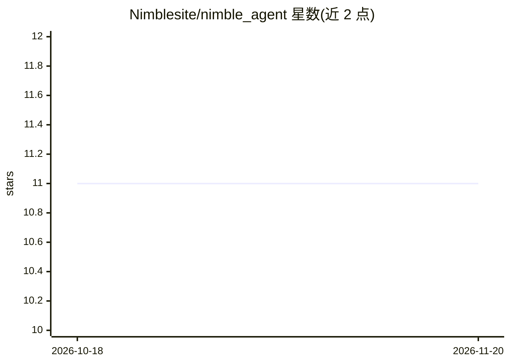

# Nimblesite/nimble_agent

⭐ 11 · Python · NOASSERTION · 推送 2026-03-26 · [GitHub](https://github.com/Nimblesite/nimble_agent) · [官网](https://www.nimblesite.co/) · 个人维护

**基于 LangChain 的终端 AI 编码助手与库**

一个基于 LangChain 构建的 CLI 编码助手，可在终端运行、从应用调用或在云/CICD 管道中运行，同时以库形式提供。核心机制是"验收标准"：以单元测试或 UI 测试等客观条件判定任务是否完成，agent 循环执行直至达标。默认使用低成本模型，目标支持尽可能多可本地运行的开源模型。长期规划多 agent 支持，由 reviewer agent 回滚明显错误并纠偏。开发须使用 VS Code Dev Containers（Docker + Python 3.12 + Flutter）。

## 筛选速览

| 维度 | 判定 | 备注 |
|---|---|---|
| AI 角色 | `ai-native` | 本体是模型或模型工具 |
| 许可风险 | `none` | NOASSERTION |
| 部署形态 | `None` |  |
| 模型依赖 | — | README 未给出锁定关系 |
| 硬件要求 | — | 无带数字的原话,不猜 |
| 安装摩擦 | `low` | 无编译、无系统依赖或容器化 |
| 成熟度 | `idea` | |

## 能力要点

- 验收标准驱动的循环执行：以可测试的客观条件判定任务成功
- 默认使用低成本模型，目标是支持可本地运行的开源模型
- 规划中的 reviewer agent 用于回滚错误代码与纠偏
- 可在终端、应用调用或云/CICD 管道中运行

## 适用场景

- 在终端用 AI 助手完成以测试为验收标准的编码任务
- 把编码 agent 集成到 CICD 管道中执行代码任务
- 以库形式在自己的应用中调用编码 agent 能力

## 场景标签

`编码 Agent` `Agent 框架` · 领域:Agent 开发

## 证据(README 行号)

> L3: A LangChain, CLI based AI coding assistant and library aimed at fixing common issues that exist in other AI agents. 
> L7: The agent introduces the concept of "acceptance criteria". This tells the agent how to check if the task has succeed

## 星数曲线

2026-10-18 11 → 2026-11-20 11（+0）

---
*卡片 v1 · prompt 1.4 · 生成 2026-11-19 · 置信度 mid · 依据 README sha `10b032afe5cb` · [字段定义](../../DATASET.md)*
