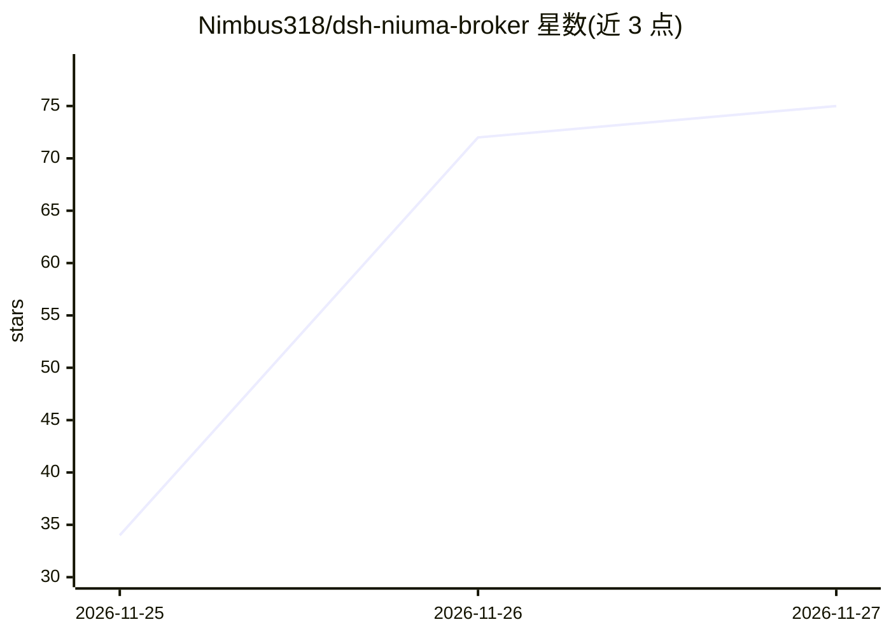

# Nimbus318/dsh-niuma-broker

⭐ 75 · JavaScript · MIT · 推送 2026-11-26 · [GitHub](https://github.com/Nimbus318/dsh-niuma-broker) · [官网](https://niumabroker.nimbus-nimo.com/) · 个人维护 · 中文 README

**DeepSeek Harness 插件：求职者的目标寻岗与简历管理工具**

以 DeepSeek Harness 插件形式提供的个人求职经纪工具：订阅目标公司官网招聘板并定时拉取新岗位，结合个人履历进行带理由的匹配打分；对岗位生成结构化解读、风险排雷与面试反问话术；基于订阅的真实 JD 语料生成五维能力雷达、技能价值象限与公司赛道热力图等市场洞察；从授权的工作区对话中提炼工作成果并经人工核对后入履历库，支持简历多主干与岗位定向分支管理。数据默认保存在本机，AI 能力需在 DSH 中配置模型；macOS 支持系统日历联动，Linux/Windows 支持核心功能。

## 筛选速览

| 维度 | 判定 | 备注 |
|---|---|---|
| AI 角色 | `ai-native` | 本体是模型或模型工具 |
| 许可风险 | `permissive` | MIT |
| 部署形态 | `None` |  |
| 模型依赖 | — | README 未给出锁定关系 |
| 硬件要求 | — | 无带数字的原话,不猜 |
| 安装摩擦 | `low` | 无编译、无系统依赖或容器化 |
| 成熟度 | — | 结构信号不足 |

## 能力要点

- 官网招聘板定时巡检与带理由的岗位匹配打分
- 岗位深度解读、风险排雷与可回溯 JD 原文的反问话术
- 基于真实订阅 JD 的市场水温分析（雷达图/技能象限/热力图）
- 工作对话静默提炼成果，先审核后入库的事实护栏

## 适用场景

- 订阅目标公司官网并自动追踪新岗位与匹配度
- 投递前对 JD 做风险排雷并准备面试反问
- 基于真实在招岗位调整技能补齐与职业规划
- 维护简历多版本并按岗位派生定向分支

## 场景标签

`AI 助手` · 领域:对话与助手

## 证据(README 行号)

> L59:  全网官网定时巡检 · AI 逐条匹配与日程联动
> L62:  • 带理由的精准匹配 ：结合你的真实履历与求职方向打分，直接给出一句对口理由与醒目的「留意」硬伤提示
> L146: 需要 DeepSeek Harness `>=0.2.2-rc.5 <0.3.0` 与 Node.js `>=22`。

## 星数曲线

2026-11-25 34 → 2026-11-27 75（+41）

---
*卡片 v1 · prompt 1.4 · 生成 2026-11-24 · 置信度 high · 依据 README sha `33c56727d8f1` · [字段定义](../../DATASET.md)*
