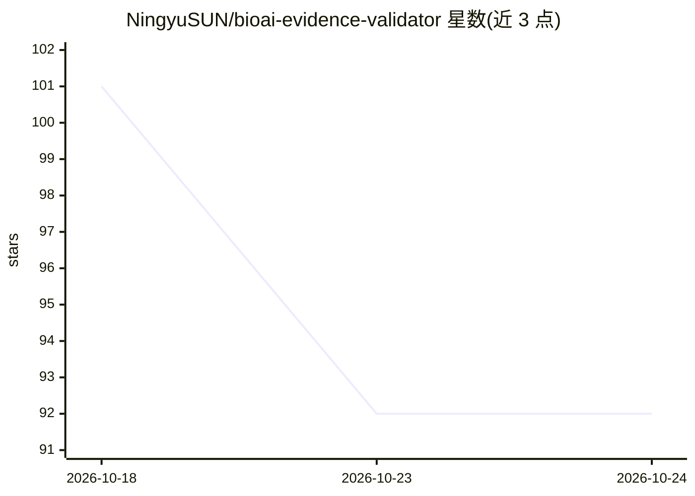

# NingyuSUN/bioai-evidence-validator

⭐ 92 · Python · Apache-2.0 · 推送 2026-10-15 · [GitHub](https://github.com/NingyuSUN/bioai-evidence-validator) · [官网](https://ningyusun.github.io/bioai-evidence-validator/) · 个人维护

**AI 生物注释结果的证据校验与准入引擎，供策展与知识库建设**

面向 AI 辅助生物策展的校验层：将 LLM/agent 产出的记录（claim+来源+证据）按 LinkML schema 验证，通过文献、本体、基因、表格等 Grounder 对固定 SHA-256 快照重算断言，再按用途 profile 判定 admit/review/reject；可修复错误以精确理由回传模型形成反馈循环，需判断的发现转交人工。附六模型（Anthropic/OpenAI/Google CLI）基准评测、26 个规则码与审计机制。以 Python 包（PyPI）与 CLI 提供。限制：语义性错误仍可通过，一项检查未通过外部验证（保留为 experimental）。

## 筛选速览

| 维度 | 判定 | 备注 |
|---|---|---|
| AI 角色 | `ai-ecosystem` | LLM/agent 周边工具 |
| 许可风险 | `permissive` | Apache-2.0 |
| 部署形态 | `library` | 以包/库形式分发 |
| 模型依赖 | — | README 未给出锁定关系 |
| 硬件要求 | — | 无带数字的原话,不猜 |
| 安装摩擦 | `low` | 无编译、无系统依赖或容器化 |
| 成熟度 | `idea` | |

## 能力要点

- 文献/本体/基因/表格五类 Grounder 对固定快照重算断言
- 按用途 profile 判定 admit/review/reject，YAML 定义免改引擎
- feedback.revise 反馈循环：可修复错误回传模型，冲突转人工
- 审计记录输入/schema/profile 哈希，26 个文档化规则码

## 适用场景

- 校验 LLM 抽取的生物文献 claim 的标识符与引文真伪
- 单细胞注释中拦截本体 ID 与标签不符的回答
- 知识库入库前按用途设置证据准入门槛

## 场景标签

`模型评测` `知识图谱` · 领域:评测与运维

## 证据(README 行号)

> L23: Bioevidence checks every AI-produced record against pinned sources and reference releases, and decides,
> L137: - **Feedback loop:** `feedback.revise` wraps any model or agent.
> L160:  - A typed Python package on PyPI, with CLI exit codes for pipelines and a GitHub Action for CI.

## 星数曲线

2026-10-18 101 → 2026-10-24 92（-9）

---
*卡片 v1 · prompt 1.4 · 生成 2026-10-23 · 置信度 high · 依据 README sha `8f3334205f16` · [字段定义](../../DATASET.md)*
