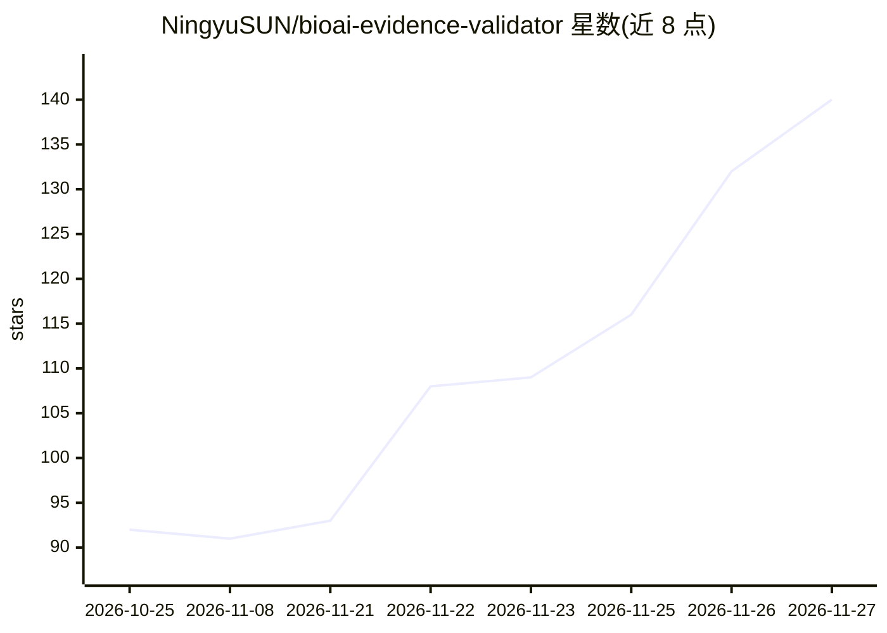

# NingyuSUN/bioai-evidence-validator

⭐ 140 · Python · Apache-2.0 · 推送 2026-11-19 · [GitHub](https://github.com/NingyuSUN/bioai-evidence-validator) · [官网](https://ningyusun.github.io/bioai-evidence-validator/) · 个人维护

**为生物策展的 AI 输出提供证据校验与准入决策的引擎**

面向 AI 辅助生物策展的校验层：对模型生成或 agent 提交的记录（文献声明、本体注释、基因/变异条目）逐条核对固定版本的来源快照，按 profile 规则输出 admitted/review/rejected 三种准入判定，并以退出码区分。机制包括 LinkML schema 校验、YAML 配置的 profile、五类 grounder（文献/本体/基因/表格/参考资源）复核、可回传修正理由的反馈回路以及记录输入与规则版本哈希的审计报告。以 PyPI 包、CLI 和 GitHub Action 形式提供，README 亦列明实测的局限与一项外部验证失败的检查。

## 筛选速览

| 维度 | 判定 | 备注 |
|---|---|---|
| AI 角色 | `ai-ecosystem` | LLM/agent 周边工具 |
| 许可风险 | `permissive` | Apache-2.0 |
| 部署形态 | `library` | 以包/库形式分发 |
| 模型依赖 | — | README 未给出锁定关系 |
| 硬件要求 | — | 无带数字的原话,不猜 |
| 安装摩擦 | `low` | 无编译、无系统依赖或容器化 |
| 成熟度 | — | 结构信号不足 |

## 能力要点

- 五类 grounder 对照固定快照复核 PMID/本体 ID/基因符号/引用原文
- 反馈回路将可修正错误回传模型，验证过的证据不可在修订中撤回
- YAML profile 定义各用途的准入规则，新领域无需改引擎
- 每个报告记录输入、schema 与 profile 的哈希及版本，含 26 个规则码

## 适用场景

- 对 LLM 抽取的文献声明做准入校验与人工分流
- 校验单细胞注释中的 Cell Ontology ID 与标记基因
- 在 pull request 中用 GitHub Action 自动检查策展记录

## 场景标签

`科研工具` · 领域:学习与行业

## 证据(README 行号)

> L27: Bioevidence checks every AI-produced record against pinned sources and reference releases, and decides,
> L109:     R --> P["Profile rules per intended use"]
> L129: - **Feedback loop:** `feedback.revise` wraps any model or agent.

## 星数曲线

2026-10-25 92 → 2026-11-27 140（+48）

---
*卡片 v1 · prompt 1.4 · 生成 2026-11-27 · 置信度 high · 依据 README sha `2a7822426c62` · [字段定义](../../DATASET.md)*
