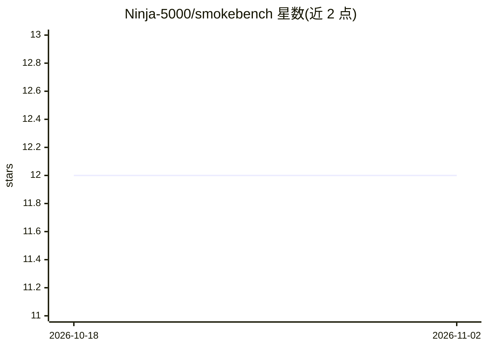

# Ninja-5000/smokebench

⭐ 12 · Python · MIT · 推送 2026-08-23 · [GitHub](https://github.com/Ninja-5000/smokebench) · 个人维护

**终端 TUI 工具：对 OpenAI/Anthropic 兼容端点做快速 LLM 冒烟测试**

基于 Textual 的 Python 终端 UI，面向在自有硬件上快速测试 LLM 端点的开发者：配置 Base URL/API key/协议后自动拉取模型列表，运行 8 个内置基准（数学、代码生成、摘要、JSON 模式、长上下文、创意写作、吞吐等），支持 LLM-judge 评分与自定义 YAML 基准，结果以可排序表格与推荐标签（best_coding/fastest/cheapest 等）呈现，并导出 JSON/Markdown 报告。直接兼容 OpenAI 与 Anthropic API 协议，可配合 Ollama、vLLM、LM Studio、SGLang 或云代理使用。作者自述定位为轻量快速冒烟测试，非大规模严谨排行榜工具。

## 筛选速览

| 维度 | 判定 | 备注 |
|---|---|---|
| AI 角色 | `ai-ecosystem` | LLM/agent 周边工具 |
| 许可风险 | `permissive` | MIT |
| 部署形态 | `library` | 以包/库形式分发 |
| 模型依赖 | local-ok | 支持本地模型 |
| 硬件要求 | — | 无带数字的原话,不猜 |
| 安装摩擦 | `medium` | 含编译或系统依赖之一 |
| 成熟度 | — | 结构信号不足 |

## 能力要点

- 8 个内置基准覆盖数学/代码/JSON 模式/长上下文/吞吐等
- 直接支持 OpenAI 与 Anthropic 两种 API 协议
- TUI 内配置端点、选模型、切换基准，无需手写 YAML
- 运行后生成推荐标签（best_coding/fastest/cheapest 等）与 Markdown/JSON 报告
- 支持自定义 YAML 基准与可选 LLM-judge 评分

## 适用场景

- 在本地量化模型上快速检查是否够用、微调是否有提升
- 对比多个端点/模型在特定 schema 约束下的表现
- 迭代 prompt 或模型时做分钟级回归检查
- 按速度与成本挑选适合场景的模型

## 场景标签

`模型评测` · 领域:评测与运维

## 证据(README 行号)

> L3: **Rapid, interactive TUI smoke tests for OpenAI- and Anthropic-compatible LLM endpoints.**
> L19: Heavy LLM evaluation frameworks (`lm-eval-harness`, `Promptfoo`) are great for research or CI/CD pipelines, but tak

## 星数曲线

2026-10-18 12 → 2026-11-02 12（+0）

---
*卡片 v1 · prompt 1.4 · 生成 2026-11-01 · 置信度 high · 依据 README sha `9588741bce54` · [字段定义](../../DATASET.md)*
