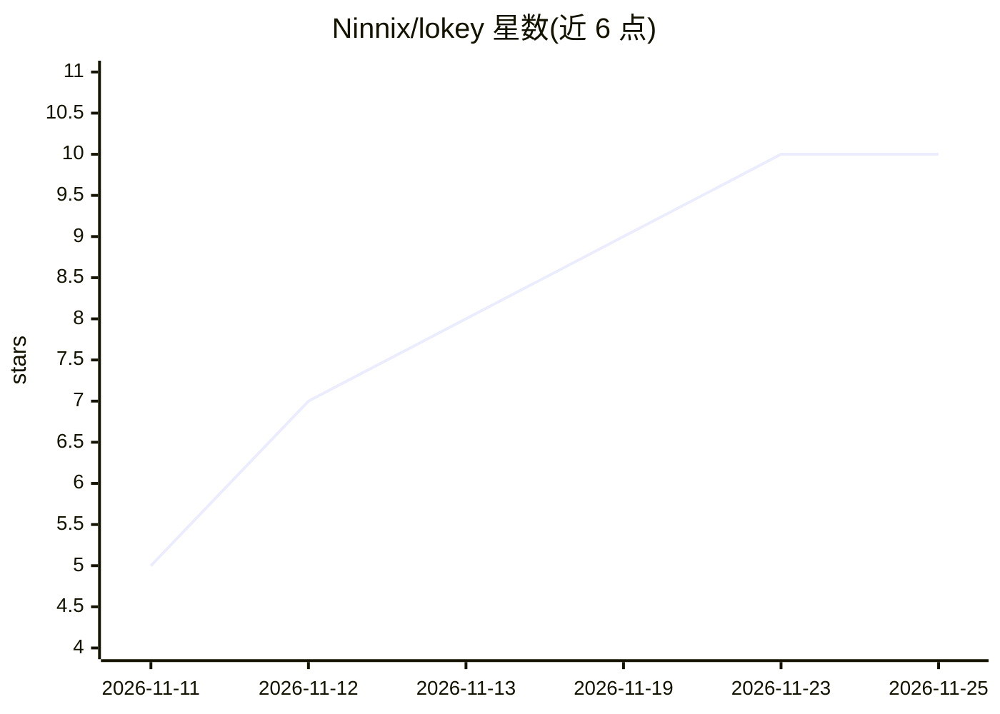

# Ninnix/lokey

⭐ 10 · Kotlin · MIT · 推送 2026-11-18 · [GitHub](https://github.com/Ninnix/lokey) · 个人维护

**本地 AI 的 Android 原生键盘：预测/听写/翻译离线运行**

以 Kotlin 与 Android Canvas 实现的 Android 输入法，内置本地词补全、语音听写与翻译，模型在手机端运行，无需账号、订阅或推理服务连接。通过 C11 桥接 llama.cpp 与 whisper.cpp 分叉运行时，支持 39 种语言与多套键盘布局；文本功能共用一个活跃模型（LFM 或 Qwen），听写用独立语音模型（Parakeet/Qwen3 ASR）。个人学习等功能默认关闭，数据经本地加密存储。提供 Google Play、签名 APK 及源码构建路径。

## 筛选速览

| 维度 | 判定 | 备注 |
|---|---|---|
| AI 角色 | `ai-native` | 本体是模型或模型工具 |
| 许可风险 | `permissive` | MIT |
| 部署形态 | `None` |  |
| 模型依赖 | — | README 未给出锁定关系 |
| 硬件要求 | — | 无带数字的原话,不猜 |
| 安装摩擦 | `high` | 编译与系统依赖俱全 |
| 成熟度 | `idea` | |

## 能力要点

- 本地运行的词建议、听写与翻译，无需推理服务连接
- 39 种语言与十一类键盘布局，支持布局与外观自定义
- 可下载 LFM/Qwen 文本模型与 Parakeet/Qwen3 ASR 语音模型，按语言硬件自动选择
- 支持 Qualcomm Hexagon NPU 执行，CPU 回退可用

## 适用场景

- 不联网输入时获得完整词建议与自动更正
- 在任意应用的输入框中把文本翻译成其他语言
- 长按回车进行本地语音听写
- 隐私敏感场景下避免输入内容上传服务器

## 场景标签

`语音识别` · 领域:感知与多模态

## 证据(README 行号)

> L7: **Lokey** is an Android keyboard with local word prediction, dictation and
> L8: translation. The models run on your phone. Writing a message does not require
> L86: Prediction, translation and speech recognition run locally. The app has no

## 星数曲线

2026-11-11 5 → 2026-11-25 10（+5）

---
*卡片 v1 · prompt 1.4 · 生成 2026-11-20 · 置信度 high · 依据 README sha `7bc6a57bb1a2` · [字段定义](../../DATASET.md)*
