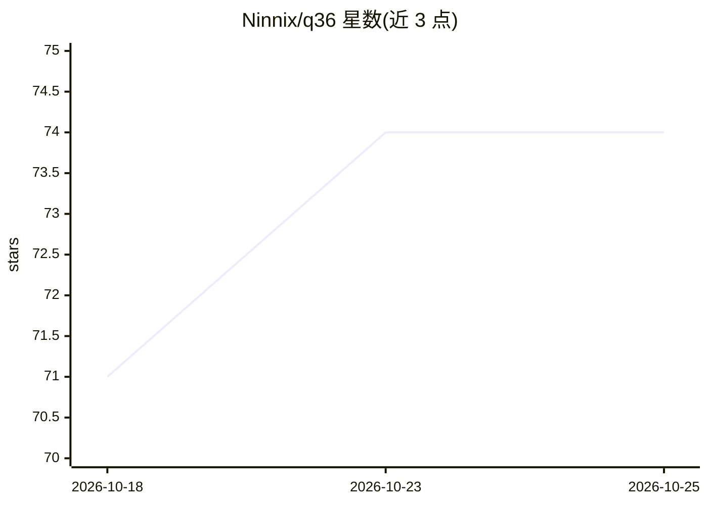

# Ninnix/q36

⭐ 74 · C · MIT · 推送 2026-10-25 · [GitHub](https://github.com/Ninnix/q36) · 个人维护

**面向 Qwen3.6/3.8 两款模型的本地推理引擎（Vulkan/Metal）**

原生小型推理引擎，专用于 Qwen3.6-35B-A3B 与 Qwen3.8-27B 两款模型，刻意不做通用 GGUF 运行器。提供 Vulkan（Linux，AMD BC-250 为主测试设备）与 Metal（Apple Silicon M1+）两种 GPU 后端，CPU 为参考调试路径；包含 CLI、HTTP 服务器、coding agent、评测与基准工具，支持 SSD 流式加载与视觉 projector 边车。源码 make 编译安装，自述 alpha 阶段、变动频繁，不支持 Windows 构建。

## 筛选速览

| 维度 | 判定 | 备注 |
|---|---|---|
| AI 角色 | `ai-ecosystem` | LLM/agent 周边工具 |
| 许可风险 | `permissive` | MIT |
| 部署形态 | `None` |  |
| 模型依赖 | — | README 未给出锁定关系 |
| 硬件要求 | — | 无带数字的原话,不猜 |
| 安装摩擦 | `low` | 无编译、无系统依赖或容器化 |
| 成熟度 | `idea` | |

## 能力要点

- Qwen3.6-35B-A3B 专用 Vulkan/Metal 图执行器，含 KV 状态与 MTP 支持
- CLI、OpenAI 兼容 HTTP 服务器、coding agent、评测 harness 与基准同套使用
- RAM 不足时 SSD 流式加载，16 GB Mac / 16 GB BC-250 可运行默认模型
- 视觉 projector 以磁盘边车方式逐张量流式加载，不常驻内存

## 适用场景

- 在 16 GB 级别廉价硬件（如 AMD BC-250）上本地跑 Qwen MoE 模型
- Apple Silicon 上以 Metal 后端运行同套 CLI/agent/服务器
- 本地运行 coding agent 与 OpenAI 兼容推理服务

## 场景标签

`推理引擎` `编码 Agent` · 领域:编码与开发

## 证据(README 行号)

> L3: **QuarkStar** is a small native inference engine for **Qwen3.6-35B-A3B**,
> L6: The main paths are `qwen35moe`-specific Vulkan and Metal graph executors with
> L7: Q36-specific loading, prompt rendering, tool calls, KV state, HTTP server,

## 星数曲线

2026-10-18 71 → 2026-10-25 74（+3）

---
*卡片 v1 · prompt 1.4 · 生成 2026-10-24 · 置信度 high · 依据 README sha `91ad2522acd4` · [字段定义](../../DATASET.md)*
