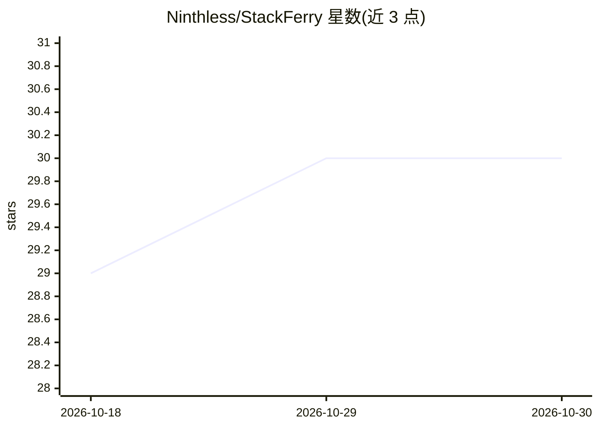

# Ninthless/StackFerry

⭐ 30 · TypeScript · GPL-3.0 · 推送 2026-10-28 · [GitHub](https://github.com/Ninthless/StackFerry) · 个人维护 · 中文 README

**桌面工具：统一管理 Codex/Claude Code/Grok 的供应商与本地故障转移路由**

Electron 桌面应用，作为编码 CLI 的控制平面：为 Codex、Claude Code、Grok 配置官方登录或自定义网关供应商，写入前先备份并改写各 CLI 的实际配置文件；支持每 CLI 一条故障转移队列，经 127.0.0.1 回环代理与熔断器转发；另提供 SKILL.md 技能导入（可投影到 Claude/Codex/Grok/DeepSeek Harness）、MCP 服务器管理、CLI 二进制检测安装更新。退出时恢复路由配置。提供 Windows/Linux/macOS 安装包。macOS 为 ad-hoc 签名，不支持应用内更新。

## 筛选速览

| 维度 | 判定 | 备注 |
|---|---|---|
| AI 角色 | `ai-ecosystem` | LLM/agent 周边工具 |
| 许可风险 | `viral` | GPL-3.0 |
| 部署形态 | `desktop` | 安装包/桌面程序 |
| 模型依赖 | — | README 未给出锁定关系 |
| 硬件要求 | — | 无带数字的原话,不猜 |
| 安装摩擦 | `low` | 无编译、无系统依赖或容器化 |
| 成熟度 | — | 结构信号不足 |

## 能力要点

- 每 CLI 一条本地故障转移队列，回环代理带熔断器
- 写入前备份并改写 CLI 配置，退出时恢复直连
- SKILL.md 技能导入与 MCP 服务器管理，可应用到多个 CLI
- stackferry:// 链接从网关一键导入供应商配置

## 适用场景

- 在多个编码 CLI 间切换供应商或自定义网关而不手工改配置
- 为 Claude Code/Codex/Grok 配置供应商故障转移链
- 集中管理各 CLI 的 Skills 与 MCP 服务器定义

## 场景标签

`模型网关` · 领域:Agent 开发

## 证据(README 行号)

> L12: Desktop control plane for coding CLIs. It keeps providers, local failover, Skills, and MCP in one place, then write
> L34: - **Local routing.** One failover queue per CLI. A non-empty queue sends that CLI through a loopback proxy with a c

## 星数曲线

2026-10-18 29 → 2026-10-30 30（+1）

---
*卡片 v1 · prompt 1.4 · 生成 2026-10-26 · 置信度 mid · 依据 README sha `d842e007d128` · [字段定义](../../DATASET.md)*
