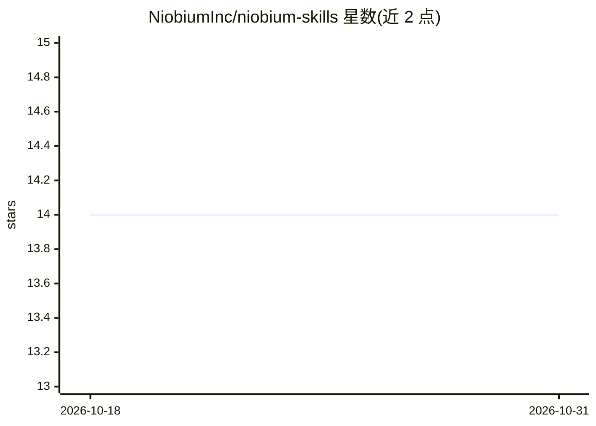

# NiobiumInc/niobium-skills

⭐ 14 · C++ · NOASSERTION · 推送 2026-10-30 · [GitHub](https://github.com/NiobiumInc/niobium-skills) · 组织维护

**指导 AI 编程代理构建 FHE 加密计算应用的技能包**

Niobium 维护的 Agent Skills 集合：以 SKILL.md 便携包形式，为支持开放 Agent Skills 标准的编程代理（Claude Code、Codex CLI、Cursor、Gemini CLI、Copilot、Windsurf 等）提供构建全同态加密（FHE）应用的方法论。核心技能 fhe-application-design 覆盖 0–10 共 11 个设计阶段，基于 OpenFHE（可选 Niobium DSL），构建与运行阶段需 Docker 拉取 FHE-dev 容器（含 OpenFHE 定制分支），设计阶段 1–7 无需安装。提供 npx、gh、Claude Code 插件市场、Cowork 插件 UI 与手动 clone 五种安装方式。

## 筛选速览

| 维度 | 判定 | 备注 |
|---|---|---|
| AI 角色 | `ai-knowledge` | 知识聚合/清单类 |
| 许可风险 | `none` | NOASSERTION |
| 部署形态 | `self-host` | docker 或自建部署 |
| 模型依赖 | — | README 未给出锁定关系 |
| 硬件要求 | — | 无带数字的原话,不猜 |
| 安装摩擦 | `low` | 无编译、无系统依赖或容器化 |
| 成熟度 | — | 结构信号不足 |

## 能力要点

- fhe-application-design 技能：0–10 共 11 阶段的 FHE 应用设计方法论（专利申请中）
- 兼容开放 Agent Skills 标准的多种编程代理（Claude Code、Codex CLI、Cursor、Gemini CLI、Copilot、Windsurf）
- FHE-dev Docker 容器（含 Niobium 定制 OpenFHE 分支与 libnbfhetch）
- 五种安装途径：npx skills add / gh CLI / Claude Code 插件市场 / Cowork 插件 UI / 手动 clone

## 适用场景

- 让 AI 编程代理按阶段化方法论设计 FHE 应用
- 评估全同态加密方案的可行性与参数选择
- 在加密数据上构建客户端–服务器计算协议

## 场景标签

 · 领域:密码学/隐私计算开发工具

## 证据(README 行号)

> L3: AI Agent Skills by Niobium — portable `SKILL.md`
> L13: An eleven-stage methodology (Stages 0–10) for designing and building Fully Homomorphic
> L14: Encryption (FHE) applications with OpenFHE (optional Niobium DSL path) — from build

## 星数曲线

2026-10-18 14 → 2026-10-31 14（+0）

---
*卡片 v1 · prompt 1.4 · 生成 2026-10-31 · 置信度 high · 依据 README sha `cc9a81bef59b` · [字段定义](../../DATASET.md)*
