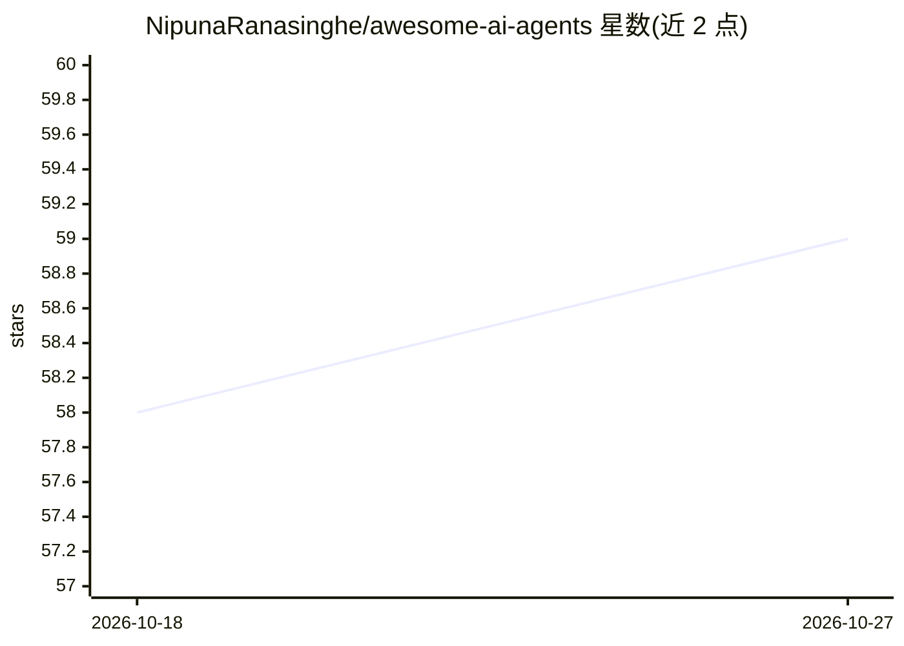

# NipunaRanasinghe/awesome-ai-agents

⭐ 59 · HTML · CC0-1.0 · 推送 2026-10-26 · [GitHub](https://github.com/NipunaRanasinghe/awesome-ai-agents) · [官网](https://nipunaranasinghe.github.io/awesome-ai-agents) · 个人维护

**AI agent 框架与工具的策展清单**

社区维护的 AI agent 主题 awesome 清单，收录构建与部署 AI agent 所需的框架、工具、库与平台资源。内容按类别组织：核心框架（AutoGen、CrewAI、LangChain 等约 40 项）、专用 agent（编码、科研、创作、浏览器/桌面操作、语音）、按编程语言分类的框架，以及记忆与运维类工具。条目以表格形式呈现名称与描述，部分含 Star 数与许可证信息，支持社区提交新项目，另有网站形式可浏览。

## 筛选速览

| 维度 | 判定 | 备注 |
|---|---|---|
| AI 角色 | `ai-knowledge` | 知识聚合/清单类 |
| 许可风险 | `viral` | CC0-1.0 |
| 部署形态 | `None` |  |
| 模型依赖 | — | README 未给出锁定关系 |
| 硬件要求 | — | 无带数字的原话,不猜 |
| 安装摩擦 | `low` | 无编译、无系统依赖或容器化 |
| 成熟度 | — | 结构信号不足 |

## 能力要点

- 按核心框架/专用agent/语言专用/运维四大板块组织的分类目录
- 覆盖编码、科研、创作、Web与桌面操作、语音等专用 agent 类别
- 表格化条目附描述，部分含 Star 数与许可证信息
- 社区共建，支持提交新项目并可用网站形式浏览

## 适用场景

- 为 AI agent 项目选型时查找和比较框架
- 按语言（TypeScript/Java/Rust 等）定位对应的 agent 框架
- 发现特定领域的专用 agent（编码、科研、浏览器自动化、语音）

## 场景标签

`精选清单` · 领域:学习与行业

## 证据(README 行号)

> L5: _A curated list of frameworks, tools, libraries, platforms, and resources for building and deploying AI agents._
> L21: ## 🌟 Core Frameworks

## 星数曲线

2026-10-18 58 → 2026-10-27 59（+1）

---
*卡片 v1 · prompt 1.4 · 生成 2026-10-24 · 置信度 high · 依据 README sha `2e07c0476a99` · [字段定义](../../DATASET.md)*
