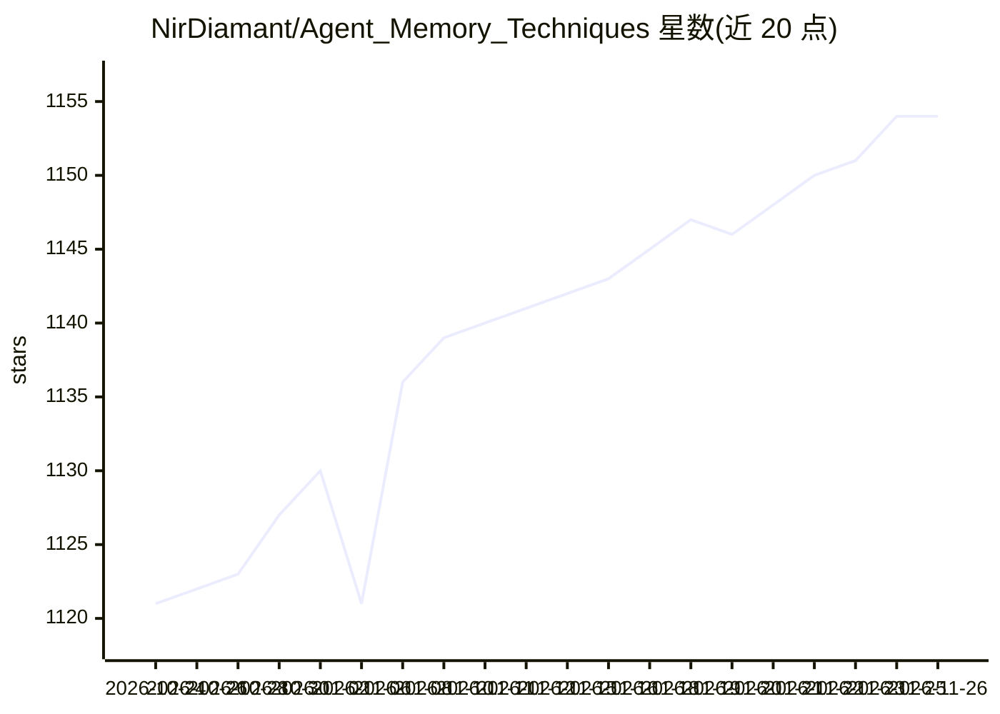

# NirDiamant/Agent_Memory_Techniques

⭐ 1,154 · Jupyter Notebook · Apache-2.0 · 推送 2026-11-01 · [GitHub](https://github.com/NirDiamant/Agent_Memory_Techniques) · [官网](https://diamantai.substack.com/) · 个人维护

**LLM Agent 记忆技术教程集：30 个可运行 Jupyter notebook**

面向学习者的 agent 记忆教程仓库：将 30 种记忆技术组织为六个族——短期上下文管理、长期存储、认知架构、检索与多智能体、框架集成、评估与生产部署，每种技术对应一个可运行的 Jupyter notebook（附 Colab 链接）。提供按目标选择技术的决策树、30 项技术对比矩阵及初/中/高级学习路径。覆盖自建模式与 Mem0、Letta、Zep、Graphiti 等框架的使用，以及 LoCoMo/LongMemEval 基准评测。作者还出版了配套书籍与相关仓库系列。

## 筛选速览

| 维度 | 判定 | 备注 |
|---|---|---|
| AI 角色 | `ai-knowledge` | 知识聚合/清单类 |
| 许可风险 | `permissive` | Apache-2.0 |
| 部署形态 | `None` |  |
| 模型依赖 | — | README 未给出锁定关系 |
| 硬件要求 | — | 无带数字的原话,不猜 |
| 安装摩擦 | `low` | 无编译、无系统依赖或容器化 |
| 成熟度 | — | 结构信号不足 |

## 能力要点

- 30 个可运行 notebook，覆盖六大记忆技术族
- 技术决策树与 30 项对比矩阵辅助选型
- 覆盖 Mem0、Letta、Zep、Graphiti 框架实战与 LoCoMo 基准评测
- 分初/中/高级学习路径

## 适用场景

- 为 LLM agent 选择合适的记忆方案并动手实现
- 学习跨会话、知识图谱、情景记忆等长期记忆模式
- 对比不同记忆框架并做基准评测
- 将记忆系统部署到生产环境（缓存、TTL、合规）

## 场景标签

`Agent 记忆` `教程课程` · 领域:Agent 开发

## 证据(README 行号)

> L7:  Agent Memory Techniques for LLMs: 30 runnable Jupyter notebooks covering every major memory pattern
> L53: > **Agent memory** is the set of techniques that let an LLM-based agent (a system built around a Large Language Mod
> L80: |Family|What it solves|Techniques|

## 星数曲线

2026-10-24 1,121 → 2026-11-26 1,154（+33）

---
*卡片 v1 · prompt 1.4 · 生成 2026-11-24 · 置信度 high · 依据 README sha `9078e0564c9f` · [字段定义](../../DATASET.md)*
