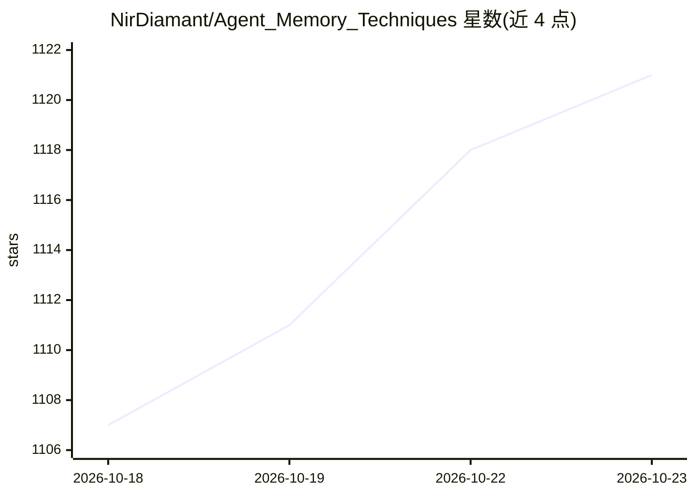

# NirDiamant/Agent_Memory_Techniques

⭐ 1,121 · Jupyter Notebook · Apache-2.0 · 推送 2026-10-17 · [GitHub](https://github.com/NirDiamant/Agent_Memory_Techniques) · [官网](https://diamantai.substack.com/) · 个人维护

**30 个可运行 Notebook 讲授 LLM Agent 记忆技术**

面向学习者的 Agent 记忆技术教程仓库：以 30 个可运行的 Jupyter Notebook 覆盖短期上下文管理、长期存储、认知架构、检索与多agent、框架（Graphiti/Mem0/Letta/Zep）及评测与生产部署共 6 大类，每项技术一个 Notebook，提供决策树与对照矩阵辅助选型，另含 LoCoMo/LongMemEval 基准与生产模式（缓存/TTL/分片/GDPR）。由个人作者维护，README 中推广其付费课程与书籍；环境要求 Python 3.10+ 与 Jupyter。

## 筛选速览

| 维度 | 判定 | 备注 |
|---|---|---|
| AI 角色 | `ai-knowledge` | 知识聚合/清单类 |
| 许可风险 | `permissive` | Apache-2.0 |
| 部署形态 | `None` |  |
| 模型依赖 | — | README 未给出锁定关系 |
| 硬件要求 | — | 无带数字的原话,不猜 |
| 安装摩擦 | `low` | 无编译、无系统依赖或容器化 |
| 成熟度 | — | 结构信号不足 |

## 能力要点

- 30 项技术按 6 大类组织，每项一个可运行 Notebook
- 覆盖 Graphiti、Mem0、Letta(MemGPT)、Zep 等记忆框架实操
- 含 LoCoMo / LongMemEval 记忆基准评测与生产部署模式
- 提供学习路径、决策树与 30 项技术对照矩阵

## 适用场景

- 系统学习 LLM agent 的各类记忆实现方式
- 按需选型记忆方案（短期/长期/认知架构/框架）
- 为自建 agent 记忆系统跑基准评测

## 场景标签

`教程课程` `Agent 记忆` · 领域:Agent 开发

## 证据(README 行号)

> L3:  Agent Memory Techniques for LLMs: 30 runnable Jupyter notebooks covering every major memory pattern
> L9: > 🧭 **New here?** Start with 01 Conversation Buffer Memory or pick a Learning Path. Prefer a visual? See the Decisio
> L60: >

## 星数曲线

2026-10-18 1,107 → 2026-10-23 1,121（+14）

---
*卡片 v1 · prompt 1.4 · 生成 2026-10-21 · 置信度 high · 依据 README sha `dbd695f02d71` · [字段定义](../../DATASET.md)*
