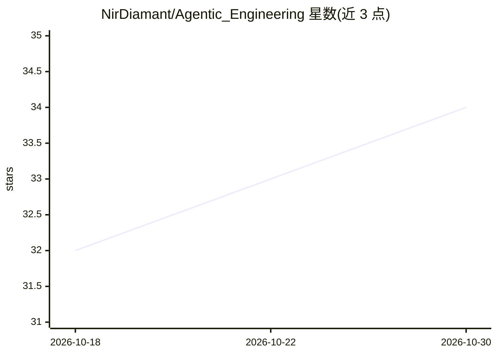

# NirDiamant/Agentic_Engineering

⭐ 34 · Python · Apache-2.0 · 推送 2026-10-27 · [GitHub](https://github.com/NirDiamant/Agentic_Engineering) · [官网](https://www.diamant-ai.com/courses?utm_source=github&utm_medium=repo-homepage&utm_campaign=agentic-engineering) · 个人维护

**为编程 agent 生成项目记忆层并自测知识得分**

面向使用 Claude Code、Codex、Cursor 等编程 agent 的开发者：先让 agent 冷启动回答关于本仓库的五个问题，再从真实代码生成 docs/ 记忆层（TECH_STACK.md、CLAUDE.md 等），之后重答同样问题并打印得分，同时统计项目自身文档与代码矛盾的条数。以粘贴一行提示词的方式运行，在 Claude Code 中可作为插件安装并支持 /org-card 团队多仓库评分。声明该层不强制 agent 遵循，非 Claude Code 环境下由同会话自评，结果需人工复核。

## 筛选速览

| 维度 | 判定 | 备注 |
|---|---|---|
| AI 角色 | `ai-ecosystem` | LLM/agent 周边工具 |
| 许可风险 | `permissive` | Apache-2.0 |
| 部署形态 | `None` |  |
| 模型依赖 | — | README 未给出锁定关系 |
| 硬件要求 | — | 无带数字的原话,不猜 |
| 安装摩擦 | `low` | 无编译、无系统依赖或容器化 |
| 成熟度 | — | 结构信号不足 |

## 能力要点

- 冷启动五问前后对比，输出 agent 记忆得分卡
- 从真实代码生成 docs/ 记忆层与技术决策记录
- 支持多仓库/monorepo 的团队级 /org-card 评分
- 统计项目自身文档中被代码推翻的声明数

## 适用场景

- 为自己的仓库生成编程 agent 可读的项目记忆层
- 评估团队多个仓库对 agent 的可理解程度
- 发现项目文档与实际代码不一致之处

## 场景标签

`Agent 记忆` · 领域:Agent 开发

## 证据(README 行号)

> L25: Clone https://github.com/NirDiamant/Agentic_Engineering into a temp folder, read its RUN.md, and follow it on this 
> L28: That line works in Claude Code, Codex, Cursor and any agent that can clone and read. In Claude Code it is also a pl
> L38: - It writes `docs/`, one instruction file at your repo root (plus a one-line pointer if your tools need the other n

## 星数曲线

2026-10-18 32 → 2026-10-30 34（+2）

---
*卡片 v1 · prompt 1.4 · 生成 2026-10-25 · 置信度 high · 依据 README sha `f770f03f90b2` · [字段定义](../../DATASET.md)*
