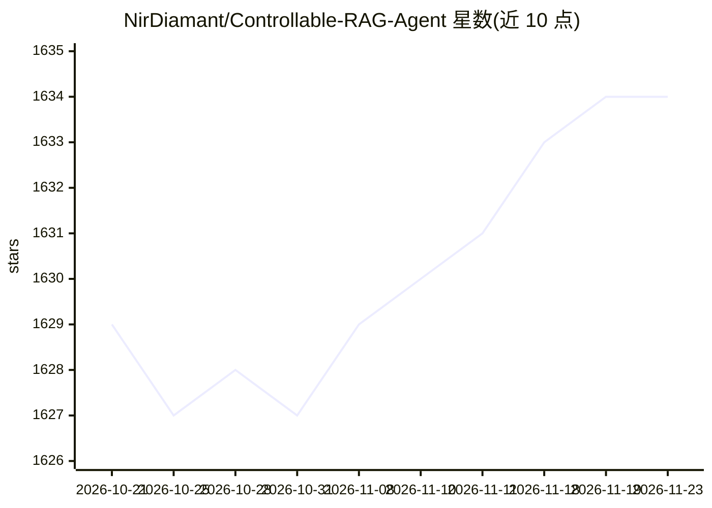

# NirDiamant/Controllable-RAG-Agent

⭐ 1,634 · Jupyter Notebook · Apache-2.0 · 推送 2026-11-01 · [GitHub](https://github.com/NirDiamant/Controllable-RAG-Agent) · 个人维护

**图控 RAG 代理：对自有数据回答复杂多跳问题**

一个面向复杂问答的检索增强生成方案实现：用确定性图作为代理的"大脑"，对自有 PDF 文档执行分章加载、摘要、向量入库，问答时对问题做匿名化、生成计划、拆解为检索/回答任务、蒸馏检索内容、链式推理生成答案，并进行基于上下文的验证与重规划以约束答案仅来自提供的数据。评估采用 Ragas 指标（正确性、忠实度、相关性、召回、相似度）。提供 Harry Potter 书籍分析的 step-by-step notebook 与 Streamlit 实时可视化，支持 pip 或 Docker 运行，需自备 LLM 提供商 API key。

## 筛选速览

| 维度 | 判定 | 备注 |
|---|---|---|
| AI 角色 | `ai-native` | 本体是模型或模型工具 |
| 许可风险 | `permissive` | Apache-2.0 |
| 部署形态 | `self-host` | docker 或自建部署 |
| 模型依赖 | — | README 未给出锁定关系 |
| 硬件要求 | — | 无带数字的原话,不猜 |
| 安装摩擦 | `low` | 无编译、无系统依赖或容器化 |
| 成熟度 | — | 结构信号不足 |

## 能力要点

- 确定性图驱动的可控代理，多步任务拆解与自适应重规划
- 问题匿名化以避免 LLM 预训练知识干扰计划生成
- 基于上下文的答案验证（引用 Self-RAG 论文方法）
- Ragas 指标评估与 Streamlit 实时代理可视化

## 适用场景

- 对自己的长文档（如整本书）做多跳推理问答
- 需要答案严格限定在检索资料、防止编造的场景
- 学习高级 RAG 流水线（计划、蒸馏、验证环节）的实现方式

## 场景标签

`RAG` `文档问答` · 领域:知识与检索

## 证据(README 行号)

> L13: An advanced Retrieval-Augmented Generation (RAG) solution designed to tackle complex questions that simple semantic
> L65: 6. **Question Processing**:
> L76: 9. **Final Answer Generation**: Produce the final answer using accumulated context and chain-of-thought reasoning.

## 星数曲线

2026-10-21 1,629 → 2026-11-23 1,634（+5）

---
*卡片 v1 · prompt 1.4 · 生成 2026-11-23 · 置信度 high · 依据 README sha `48153825443b` · [字段定义](../../DATASET.md)*
