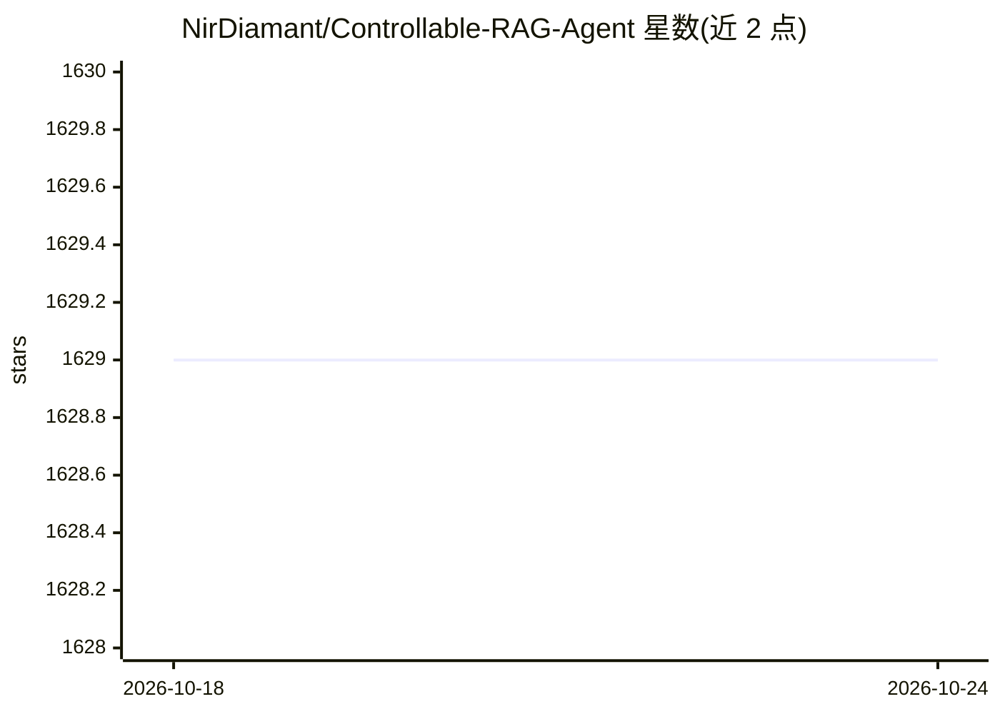

# NirDiamant/Controllable-RAG-Agent

⭐ 1,627 · Jupyter Notebook · Apache-2.0 · 推送 2026-10-24 · [GitHub](https://github.com/NirDiamant/Controllable-RAG-Agent) · 个人维护

**基于确定性图的复杂问答 RAG Agent 参考实现**

用 LangChain/LangGraph 构建的可控 RAG Agent：加载 PDF 并分章、LLM 生成章节摘要、将原文与摘要编码进 FAISS 向量库；对问题做匿名化后生成高层计划，再拆解为检索或作答任务逐步执行，带内容验证与重规划循环，并以 Ragas 指标评估。以《哈利·波特》第一册为演示用例，提供 Jupyter 教程与 Streamlit 实时可视化，支持 Docker 或源码方式运行，需自备 LLM API key（OpenAI/Groq 等）。

## 筛选速览

| 维度 | 判定 | 备注 |
|---|---|---|
| AI 角色 | `ai-native` | 本体是模型或模型工具 |
| 许可风险 | `permissive` | Apache-2.0 |
| 部署形态 | `self-host` | docker 或自建部署 |
| 模型依赖 | — | README 未给出锁定关系 |
| 硬件要求 | — | 无带数字的原话,不猜 |
| 安装摩擦 | `low` | 无编译、无系统依赖或容器化 |
| 成熟度 | — | 结构信号不足 |

## 能力要点

- 确定性图作为 Agent 控制核心，任务分解与自适应规划
- 问题匿名化以规避 LLM 预训练知识偏差
- 答案落地验证与重规划循环（参考 Self-RAG）
- Ragas 指标评估（正确性/忠实度/相关性等）

## 适用场景

- 在自有 PDF 数据上做需要多跳推理的复杂问答
- 学习或演示可控 RAG Agent 的规划与验证机制
- 对比确定性图 Agent 与传统单步检索 RAG 的差异

## 场景标签

`RAG` `教程课程` · 领域:知识与检索

## 证据(README 行号)

> L9: An advanced Retrieval-Augmented Generation (RAG) solution designed to tackle complex questions that simple semantic 
> L78: - **Sophisticated Deterministic Graph**: Acts as the "brain" of the agent, enabling complex reasoning.
> L130: The agent's ability to break down and solve such complex queries demonstrates its sophisticated reasoning capabili

## 星数曲线

2026-10-18 1,629 → 2026-10-24 1,629（+0）

---
*卡片 v1 · prompt 1.4 · 生成 2026-10-21 · 置信度 mid · 依据 README sha `74d03e61dfe0` · [字段定义](../../DATASET.md)*
