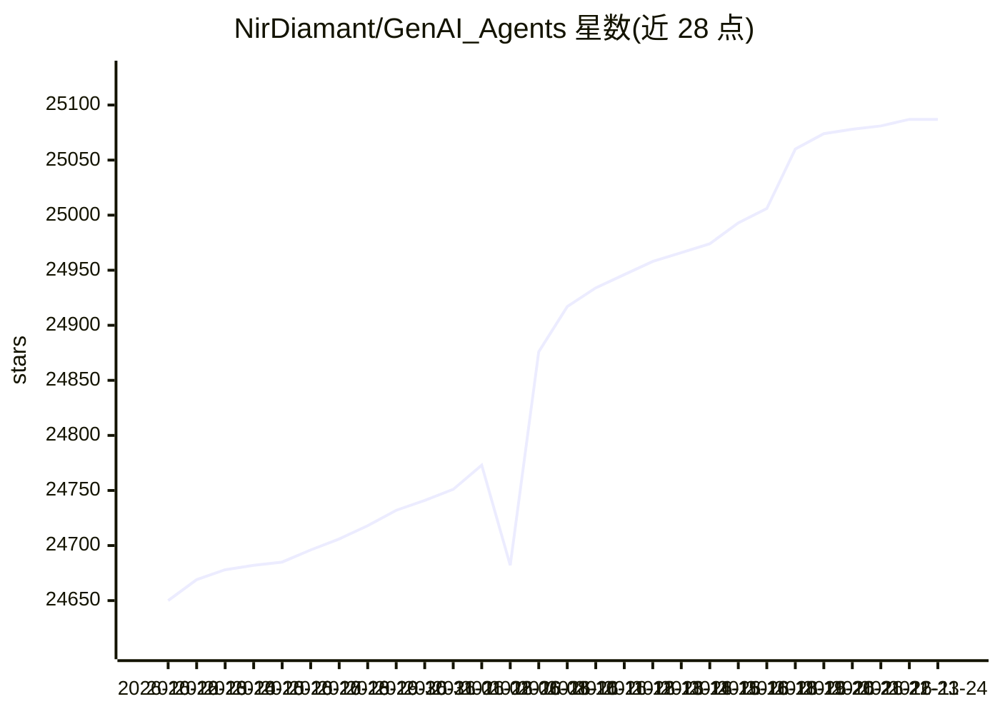

# NirDiamant/GenAI_Agents

⭐ 25,095 · Jupyter Notebook · NOASSERTION · 推送 2026-11-02 · [GitHub](https://github.com/NirDiamant/GenAI_Agents) · [官网](https://diamant-ai.com) · 个人维护

**GenAI agent 技术教程与实现集合：从对话机器人到多智能体系统**

以 Jupyter notebook 为主的教学仓库，收录 64 个 GenAI agent 教程与实现，按难度和应用领域分类，覆盖 LangChain、LangGraph、PydanticAI、AutoGen 等框架，并提供配套书籍与 YouTube 讲解。每个 notebook 需自备 API key，2026-10-31 更新说明部分 notebook 未在真实服务上端到端运行过，旧模型 ID 已替换为现行版本。面向从入门到进阶的学习者与开发者。

## 筛选速览

| 维度 | 判定 | 备注 |
|---|---|---|
| AI 角色 | `ai-knowledge` | 知识聚合/清单类 |
| 许可风险 | `none` | NOASSERTION |
| 部署形态 | `library` | 以包/库形式分发 |
| 模型依赖 | local-ok | 支持本地模型 |
| 硬件要求 | — | 无带数字的原话,不猜 |
| 安装摩擦 | `medium` | 含编译或系统依赖之一 |
| 成熟度 | — | 结构信号不足 |

## 动量与使用信号

- 维护:`active` — 距上次 push 0.7 天,年发版 0,47 位贡献者
- 涨星:近 1 天 **+13**(自 20261016 起算)
- 平台:— · 协议:MCP / OLLAMA

## 能力要点

- 64 个 agent 教程，从入门对话机器人到多智能体协作
- 12 个 2026 核心模式 notebook：路由、agent 循环、反思、计划执行、评估等
- 按初学者/框架/教育/商业/创意/分析等类别组织的用例表格
- 配套书籍、博客文章与 YouTube 系列讲解

## 适用场景

- 学习构建第一个 AI agent 的完整流程
- 参考 LangGraph 多智能体系统的实现范例
- 按业务场景（客服/合同分析/旅行规划）查找 agent 模板

## 场景标签

`教程课程` `多智能体` · 领域:Agent 开发

## 证据(README 行号)

> L13: Welcome to one of the most extensive and dynamic collections of Generative AI (GenAI) agent tutorials and implement
> L116: - 🎓 Learn to build GenAI agents from beginner to advanced levels
> L133: |Ch.|Pattern|Notebook|

## 星数曲线

2026-10-22 24,650 → 2026-11-24 25,087（+437）

---
*卡片 v1 · prompt 1.4 · 生成 2026-11-22 · 置信度 mid · 依据 README sha `0f46de839e22` · [字段定义](../../DATASET.md)*
