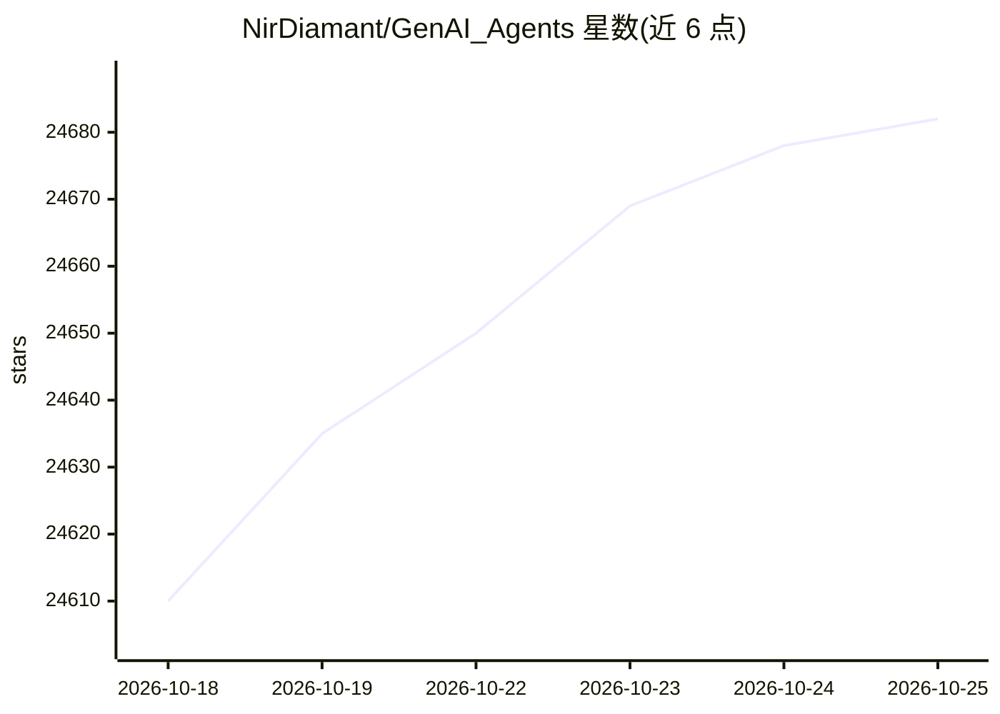

# NirDiamant/GenAI_Agents

⭐ 24,682 · Jupyter Notebook · NOASSERTION · 推送 2026-10-22 · [GitHub](https://github.com/NirDiamant/GenAI_Agents) · [官网](https://diamant-ai.com) · 个人维护

**面向学习者的 50+ 生成式 AI Agent 教程与实现合集**

以教程/笔记本形式组织的生成式 AI Agent 合集，按初学者、框架、教育、商业、创意、分析、新闻等分类收录 57 个实现，每个条目标注所用框架（LangChain、LangGraph、PydanticAI、AutoGen、CrewAI 等）与关键功能，涵盖对话机器人、多智能体协作、RAG Agent、任务与内容生成等。仓库还提供作者付费课程、newsletter、YouTube 讲解频道及配套项目（RAG Techniques、Agent Memory Techniques 等），接受社区贡献。

## 筛选速览

| 维度 | 判定 | 备注 |
|---|---|---|
| AI 角色 | `ai-ecosystem` | LLM/agent 周边工具 |
| 许可风险 | `none` | NOASSERTION |
| 部署形态 | `None` |  |
| 模型依赖 | local-ok | 支持本地模型 |
| 硬件要求 | — | 无带数字的原话,不猜 |
| 安装摩擦 | `medium` | 含编译或系统依赖之一 |
| 成熟度 | — | 结构信号不足 |

## 动量与使用信号

- 维护:`active` — 距上次 push 0.7 天,年发版 0,47 位贡献者
- 涨星:近 1 天 **+13**(自 20261016 起算)
- 平台:— · 协议:MCP / OLLAMA

## 能力要点

- 57 个按类别组织的 Agent 教程实现，标注框架与功能
- 覆盖 LangChain、LangGraph、PydanticAI、AutoGen、CrewAI 等框架
- 从简单对话代理到多智能体系统的渐进式学习路径
- 接受社区贡献并持续更新条目

## 适用场景

- 从零开始学习构建第一个 AI Agent
- 查找特定场景（客服、论文综述、内容生成）的 Agent 实现参考
- 比较不同框架下同类 Agent 的实现方式

## 场景标签

`教程课程` · 领域:学习与行业

## 证据(README 行号)

> L9: Welcome to one of the most extensive and dynamic collections of Generative AI (GenAI) agent tutorials and implementa
> L135: |#|Category|Agent Name|Framework|Key Features|
> L137: |1|🌱 **Beginner**|Simple Conversational Agent|LangChain/PydanticAI|Context-aware conversations, history management

## 星数曲线

2026-10-18 24,610 → 2026-10-25 24,682（+72）

---
*卡片 v1 · prompt 1.4 · 生成 2026-10-18 · 置信度 high · 依据 README sha `b7f57f4f118d` · [字段定义](../../DATASET.md)*
