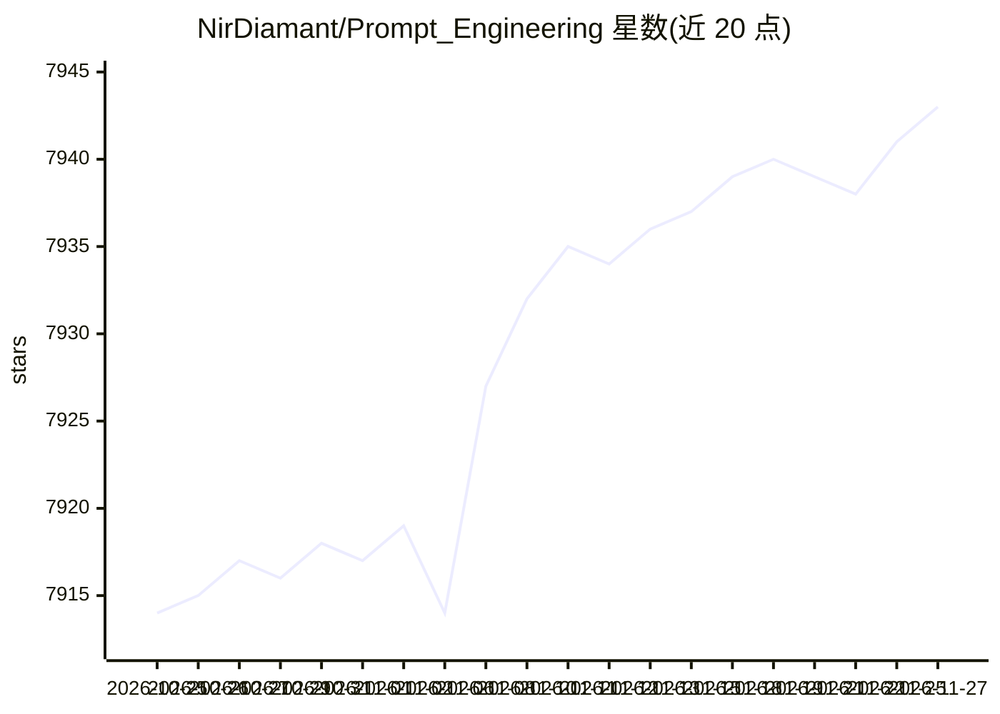

# NirDiamant/Prompt_Engineering

⭐ 7,943 · Jupyter Notebook · NOASSERTION · 推送 2026-10-31 · [GitHub](https://github.com/NirDiamant/Prompt_Engineering) · [官网](https://diamant-ai.com) · 个人维护

**面向 LLM 使用者的 22 个提示工程技术 Jupyter 教程集**

以教程合集形式组织的提示工程学习资源：22 个 hands-on Jupyter Notebook，按基础概念、核心技术、进阶策略、优化与专项应用等类别排列，覆盖零样本/少样本、思维链、自洽性、任务分解、提示链、A/B 优化、提示注入防护与效果评估等主题。示例实现使用 OpenAI 模型与 LangChain，并涉及 Jinja2 模板。仓库另有纸质/Kindle 书籍版本与配套 YouTube 讲解，接受社区贡献。

## 筛选速览

| 维度 | 判定 | 备注 |
|---|---|---|
| AI 角色 | `ai-knowledge` | 知识聚合/清单类 |
| 许可风险 | `none` | NOASSERTION |
| 部署形态 | `library` | 以包/库形式分发 |
| 模型依赖 | — | README 未给出锁定关系 |
| 硬件要求 | — | 无带数字的原话,不猜 |
| 安装摩擦 | `low` | 无编译、无系统依赖或容器化 |
| 成熟度 | — | 结构信号不足 |

## 能力要点

- 22 个 hands-on Notebook，按 6 个类别从基础到进阶组织
- 每个技术含 Overview 与 Implementation 两节说明
- 示例使用 OpenAI 模型、LangChain 与 Jinja2 模板
- 另有书籍版、YouTube 系列与社区贡献渠道

## 适用场景

- 系统性学习提示工程从入门到进阶的技术
- 查找可复用的提示模板与实现示例
- 了解提示优化、防注入、效果评估等专项主题

## 场景标签

`提示工程` `教程课程` · 领域:Agent 开发

## 证据(README 行号)

> L12: Welcome to one of the most extensive and dynamic collections of Prompt Engineering tutorials and implementations av
> L109: |#|Category|Technique|Description|
> L150:  Uses OpenAI's GPT model and LangChain to demonstrate single-turn and multi-turn prompts, prompt templates, and co

## 星数曲线

2026-10-25 7,914 → 2026-11-27 7,943（+29）

---
*卡片 v1 · prompt 1.4 · 生成 2026-11-22 · 置信度 mid · 依据 README sha `ae4b91fdb08d` · [字段定义](../../DATASET.md)*
