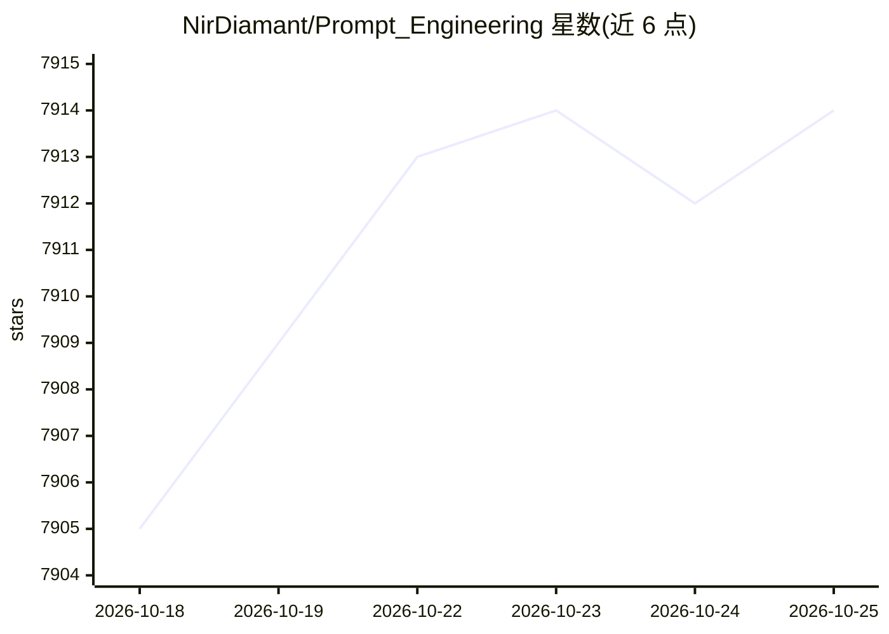

# NirDiamant/Prompt_Engineering

⭐ 7,914 · Jupyter Notebook · NOASSERTION · 推送 2026-10-24 · [GitHub](https://github.com/NirDiamant/Prompt_Engineering) · [官网](https://diamant-ai.com) · 个人维护

**22 种提示工程技术的 Jupyter Notebook 教程合集**

个人维护的提示工程（Prompt Engineering）学习资源库：以 22 个 Jupyter Notebook 教程覆盖从基础提示结构、模板变量，到少样本学习、思维链、自洽性、约束生成、提示链、A/B 测试与提示安全等主题，每个条目含概述与实现说明。实现部分使用 OpenAI GPT 模型与 LangChain 库演示。仓库同时关联作者的书（$9.99 Kindle/PDF）与付费课程（$199，17 模块）。面向从初学者到从业者的 LLM 使用者。

## 筛选速览

| 维度 | 判定 | 备注 |
|---|---|---|
| AI 角色 | `ai-knowledge` | 知识聚合/清单类 |
| 许可风险 | `none` | NOASSERTION |
| 部署形态 | `None` |  |
| 模型依赖 | — | README 未给出锁定关系 |
| 硬件要求 | — | 无带数字的原话,不猜 |
| 安装摩擦 | `low` | 无编译、无系统依赖或容器化 |
| 成熟度 | — | 结构信号不足 |

## 能力要点

- 22 个教程按基础/核心/进阶/优化/专项分类组织
- 每项技术含概述与实现（基于 OpenAI 与 LangChain）
- 覆盖 CoT、自洽性、任务分解、提示链、提示安全与效果评估
- 同主题另有书籍版（Kindle/纸质/PDF）

## 适用场景

- 系统学习从基础到高级的提示工程技术
- 在 Notebook 中动手实验少样本、思维链等策略
- 查找特定场景（多语言、安全、歧义处理）的提示方法

## 场景标签

`提示工程` `教程课程` · 领域:Agent 开发

## 证据(README 行号)

> L10: > **22 hands-on tutorials** covering everything from basic prompt templates to advanced techniques like chain-of-th
> L117: |#|Category|Technique|Description|

## 星数曲线

2026-10-18 7,905 → 2026-10-25 7,914（+9）

---
*卡片 v1 · prompt 1.4 · 生成 2026-10-20 · 置信度 high · 依据 README sha `2e0e3b3e0ac2` · [字段定义](../../DATASET.md)*
