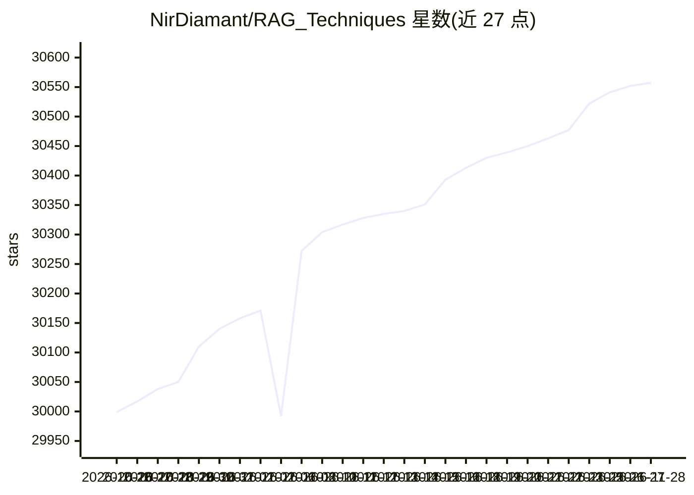

# NirDiamant/RAG_Techniques

⭐ 30,557 · Jupyter Notebook · NOASSERTION · 推送 2026-11-02 · [GitHub](https://github.com/NirDiamant/RAG_Techniques) · [官网](https://diamant-ai.com) · 个人维护

**面向研究者的 42+ 篇 RAG 技术可运行教程集**

社区驱动的 RAG 技术教程仓库，收录 42+ 个可运行 notebook，按基础、查询增强、上下文丰富、高级检索、迭代技术、评估、可解释性、高级架构等类别组织，每项技术提供直觉讲解、代码与参考文献，部分条目给出 LangChain 与 LlamaIndex 两种实现及可运行脚本。面向希望构建检索增强系统的研究者与从业者，另配套 YouTube 讲解视频与一本 400 页的配套书籍。

## 筛选速览

| 维度 | 判定 | 备注 |
|---|---|---|
| AI 角色 | `ai-knowledge` | 知识聚合/清单类 |
| 许可风险 | `none` | NOASSERTION |
| 部署形态 | `None` |  |
| 模型依赖 | — | README 未给出锁定关系 |
| 硬件要求 | — | 无带数字的原话,不猜 |
| 安装摩擦 | `low` | 无编译、无系统依赖或容器化 |
| 成熟度 | — | 结构信号不足 |

## 动量与使用信号

- 维护:`active` — 距上次 push 0.7 天,年发版 1,40 位贡献者
- 涨星:近 1 天 **+10**(自 20261016 起算)
- 平台:— · 协议:OLLAMA

## 能力要点

- 42+ 个可运行 notebook，覆盖基础到前沿的 RAG 技术
- 按 9 类组织：基础、查询增强、上下文丰富、高级检索、评估、Graph RAG 等
- 部分技术提供 LangChain 与 LlamaIndex 双实现及可运行脚本
- 配套 YouTube 视频讲解系列与书籍

## 适用场景

- 学习从基础 Simple RAG 到 Self-RAG、GraphRAG 等架构的实现方式
- 为检索系统选型参考 chunking、reranking、查询变换等技术
- 用 DeepEval、GroUSE 等条目了解 RAG 评估方法

## 场景标签

`RAG` `教程课程` · 领域:知识与检索

## 证据(README 行号)

> L8: A community-driven hub of **42+ runnable notebooks** covering RAG techniques from foundational to cutting-edge - the
> L141: |#|Category|Technique|View|

## 星数曲线

2026-10-26 29,999 → 2026-11-28 30,557（+558）

---
*卡片 v1 · prompt 1.4 · 生成 2026-11-22 · 置信度 high · 依据 README sha `1317aff6c574` · [字段定义](../../DATASET.md)*
