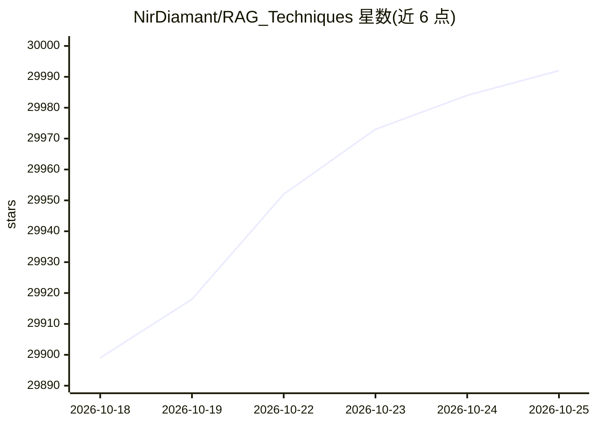

# NirDiamant/RAG_Techniques

⭐ 29,992 · Jupyter Notebook · NOASSERTION · 推送 2026-10-22 · [GitHub](https://github.com/NirDiamant/RAG_Techniques) · [官网](https://diamant-ai.com) · 个人维护

**为 RAG 开发者与研究者提供 42+ 可运行 notebook 的技术合集**

以 notebook 教程形式展示检索增强生成（RAG）的各类技术，共 42+ 个可运行示例，按基础、查询增强、上下文丰富、高级检索、迭代技术、评估、可解释性、高级架构等类别组织，每个技术附文档说明、实现指引与参考文献。部分技术提供 LangChain 与 LlamaIndex 两个版本的 notebook 及可运行脚本。仓库同时包含作者的课程、书籍、Newsletter 与 YouTube 内容推广，以及赞助商展示。

## 筛选速览

| 维度 | 判定 | 备注 |
|---|---|---|
| AI 角色 | `ai-knowledge` | 知识聚合/清单类 |
| 许可风险 | `none` | NOASSERTION |
| 部署形态 | `None` |  |
| 模型依赖 | local-ok | 支持本地模型 |
| 硬件要求 | — | 无带数字的原话,不猜 |
| 安装摩擦 | `low` | 无编译、无系统依赖或容器化 |
| 成熟度 | — | 结构信号不足 |

## 动量与使用信号

- 维护:`active` — 距上次 push 0.7 天,年发版 1,40 位贡献者
- 涨星:近 1 天 **+10**(自 20261016 起算)
- 平台:— · 协议:OLLAMA

## 能力要点

- 42+ 个可运行 RAG 技术 notebook，覆盖基础到高级架构
- 每项技术附详细文档与实现指引
- 部分技术提供 LangChain 与 LlamaIndex 双版本
- 涵盖 Graph RAG、Self-RAG、CRAG、RAPTOR 等架构

## 适用场景

- 系统学习 RAG 各类检索与分块技术
- 为 RAG 项目寻找具体技术的可运行实现参考
- 了解 RAG 评估与可解释性工具的用法

## 场景标签

`RAG` `教程课程` · 领域:知识与检索

## 证据(README 行号)

> L4: A community-driven hub of **42+ runnable notebooks** covering RAG techniques from foundational to cutting-edge - the
> L109: Retrieval-Augmented Generation (RAG) is revolutionizing the way we combine information retrieval with generative A
> L149: > **Recently added:** MemoRAG (memory-augmented retrieval), End-to-End RAG Evaluation, Open-RAG-Eval, JSON RAG. **

## 星数曲线

2026-10-18 29,899 → 2026-10-25 29,992（+93）

---
*卡片 v1 · prompt 1.4 · 生成 2026-10-18 · 置信度 high · 依据 README sha `8440fd2a673e` · [字段定义](../../DATASET.md)*
