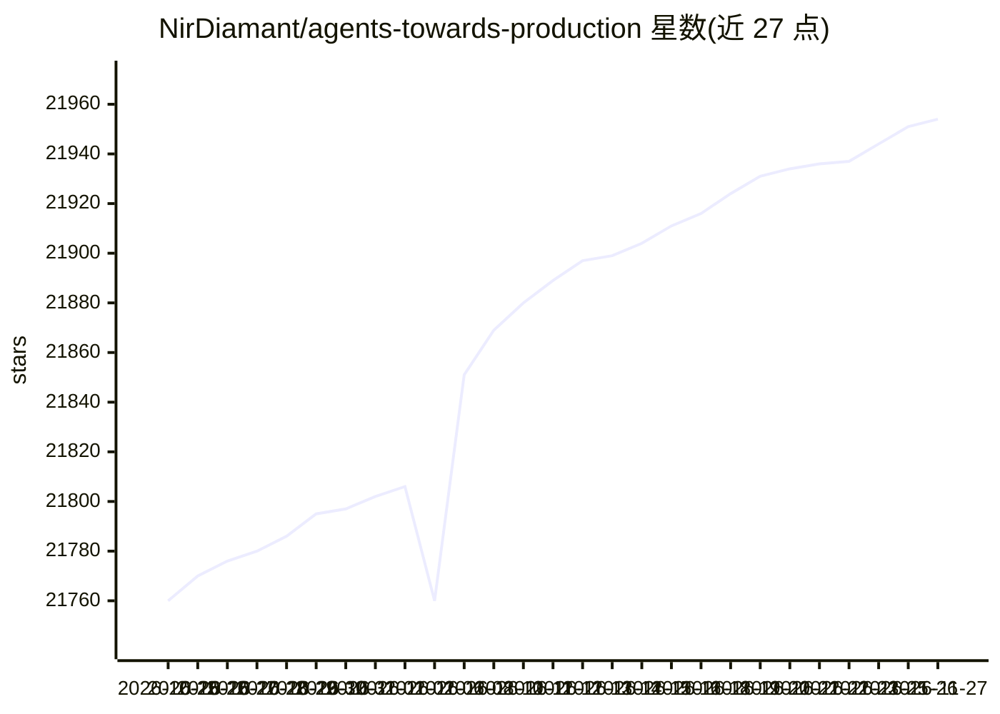

# NirDiamant/agents-towards-production

⭐ 21,954 · Jupyter Notebook · NOASSERTION · 推送 2026-11-15 · [GitHub](https://github.com/NirDiamant/agents-towards-production) · [官网](https://diamant-ai.com) · 个人维护

**面向开发者的生产级 GenAI Agent 代码教程集**

以可运行代码教程组织的教学仓库：28 个教程覆盖有状态工作流、向量记忆、实时网络搜索 API、Docker 部署、FastAPI 端点、安全护栏、GPU 扩展、浏览器自动化、微调、多 Agent 协调、可观测性、评测与 UI 开发，每个教程独立成目录并附带可直接运行的 notebook 或代码文件。面向需要将 GenAI Agent 从原型推进到企业部署的开发者。另含配套书籍、YouTube 系列与社区渠道。

## 筛选速览

| 维度 | 判定 | 备注 |
|---|---|---|
| AI 角色 | `ai-knowledge` | 知识聚合/清单类 |
| 许可风险 | `none` | NOASSERTION |
| 部署形态 | `library` | 以包/库形式分发 |
| 模型依赖 | — | README 未给出锁定关系 |
| 硬件要求 | — | 无带数字的原话,不猜 |
| 安装摩擦 | `low` | 无编译、无系统依赖或容器化 |
| 成熟度 | — | 结构信号不足 |

## 动量与使用信号

- 维护:`active` — 距上次 push 0.7 天,年发版 0,25 位贡献者
- 涨星:近 1 天 **+12**(自 20261016 起算)
- 安装:pypi 包 `meeting-recorder-agent` 月下载无数据
- 平台:— · 协议:MCP / OLLAMA

## 能力要点

- 28 个生产级教程，含可直接运行的 notebook 与代码文件
- 覆盖部署、记忆、安全护栏、可观测性、评测等完整 Agent 栈
- 含多家公司的赞助式分步教程（LangGraph、Redis、Tavily、Mem0 等）
- 配套书籍、YouTube 视频系列与社区（Reddit/Discord）

## 适用场景

- 学习把 Agent 原型部署为生产服务（Docker、FastAPI、GPU 扩展）
- 为 Agent 接入实时网络搜索、记忆系统等生产组件
- 了解多 Agent 协调、评测与可观测性的实现方式

## 场景标签

`教程课程` `多智能体` `LLM 可观测性` `模型评测` · 领域:Agent 开发

## 证据(README 行号)

> L9: **Agents Towards Production is your go‑to resource for building production‑ready GenAI agents that scale from protot
> L226: All knowledge is delivered through runnable tutorials covering orchestration, memory, observability, deployment, s

## 星数曲线

2026-10-25 21,760 → 2026-11-27 21,954（+194）

---
*卡片 v1 · prompt 1.4 · 生成 2026-11-22 · 置信度 mid · 依据 README sha `819e2e48f5eb` · [字段定义](../../DATASET.md)*
