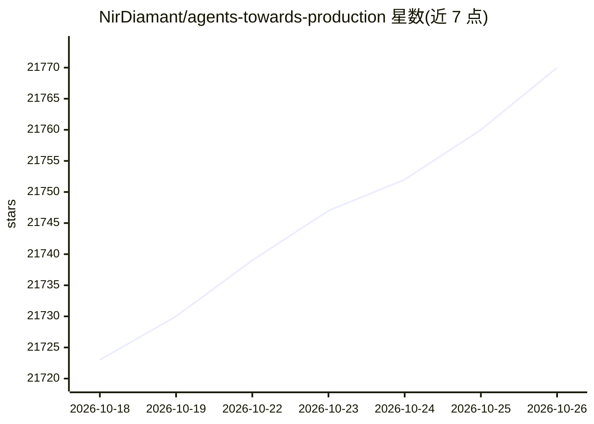

# NirDiamant/agents-towards-production

⭐ 21,770 · Jupyter Notebook · NOASSERTION · 推送 2026-10-22 · [GitHub](https://github.com/NirDiamant/agents-towards-production) · [官网](https://diamant-ai.com) · 个人维护

**面向开发者的生产级 GenAI Agent 教程合集**

以代码优先的教程仓库形式，收录 28 个覆盖 GenAI Agent 生产环节的教程，主题包括有状态工作流、向量记忆、实时网络搜索 API、Docker 部署、FastAPI 端点、安全护栏、GPU 扩展、浏览器自动化、微调、多 Agent 协调、可观测性、评估与 UI 开发。教程由多个公司以赞助形式提供，附作者付费课程、Newsletter 与 YouTube 频道。定位读者为希望将 Agent 从原型推进到企业部署的开发者。

## 筛选速览

| 维度 | 判定 | 备注 |
|---|---|---|
| AI 角色 | `ai-knowledge` | 知识聚合/清单类 |
| 许可风险 | `none` | NOASSERTION |
| 部署形态 | `library` | 以包/库形式分发 |
| 模型依赖 | — | README 未给出锁定关系 |
| 硬件要求 | — | 无带数字的原话,不猜 |
| 安装摩擦 | `low` | 无编译、无系统依赖或容器化 |
| 成熟度 | — | 结构信号不足 |

## 动量与使用信号

- 维护:`active` — 距上次 push 0.7 天,年发版 0,25 位贡献者
- 涨星:近 1 天 **+12**(自 20261016 起算)
- 安装:pypi 包 `meeting-recorder-agent` 月下载无数据
- 平台:— · 协议:MCP / OLLAMA

## 能力要点

- 28 个代码优先的生产级 Agent 教程
- 覆盖部署、安全护栏、GPU 扩展、多 Agent 协调、可观测性与评估等生产环节
- 含 LangGraph、Redis、Mem0、RunPod 等公司贡献的分步教程

## 适用场景

- 学习如何把 Agent 原型推进到生产部署
- 查找 Docker/FastAPI/GPU 扩展等 Agent 工程化环节的代码示例
- 了解多 Agent 协调与可观测性的实现方式

## 场景标签

`教程课程` · 领域:学习与行业

## 证据(README 行号)

> L5: **Agents Towards Production is your go‑to resource for building production‑ready GenAI agents that scale from protot
> L28: > **28 production-grade tutorials** covering stateful workflows, vector memory, web search APIs, Docker deployment,
> L32: Companies that have contributed step-by-step tutorials to this repository.

## 星数曲线

2026-10-18 21,723 → 2026-10-26 21,770（+47）

---
*卡片 v1 · prompt 1.4 · 生成 2026-10-18 · 置信度 mid · 依据 README sha `a3ccd5624331` · [字段定义](../../DATASET.md)*
