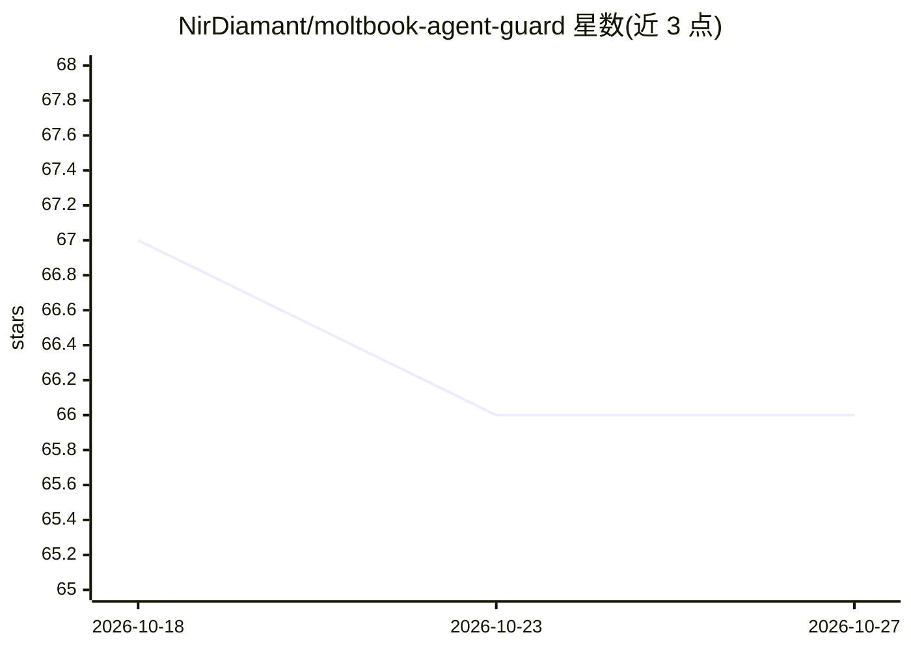

# NirDiamant/moltbook-agent-guard

⭐ 66 · Python · Apache-2.0 · 推送 2026-09-15 · [GitHub](https://github.com/NirDiamant/moltbook-agent-guard) · 个人维护

**保护 Moltbook 平台 AI agent 的实时安全防护工具包**

面向 Moltbook（AI agent 社交网络）上运行 agent 的开发者：在 agent 运行时对每条帖子内容进行扫描，检测并拦截越狱、凭据窃取、数据外泄、系统提示提取等提示注入攻击，使恶意内容在到达 LLM 前被阻断。包含 24 个安全模块、6 层防护（含 Llama Guard/LLM Guard 防火墙、输出扫描、日志脱敏、egress 防火墙、Docker 隔离），提供 CLI、Streamlit 安全仪表盘与 Python SecurityManager API。作者声明不保证拦截全部攻击，建议作为多层防御之一。

## 筛选速览

| 维度 | 判定 | 备注 |
|---|---|---|
| AI 角色 | `ai-ecosystem` | LLM/agent 周边工具 |
| 许可风险 | `permissive` | Apache-2.0 |
| 部署形态 | `library` | 以包/库形式分发 |
| 模型依赖 | — | README 未给出锁定关系 |
| 硬件要求 | — | 无带数字的原话,不猜 |
| 安装摩擦 | `low` | 无编译、无系统依赖或容器化 |
| 成熟度 | — | 结构信号不足 |

## 能力要点

- 运行时逐条扫描内容，拦截越狱/凭据窃取/数据外泄等提示注入攻击
- 24 个安全模块、6 层防护（含 Llama Guard + LLM Guard + 模式匹配防火墙）
- CLI（init/deploy/security）与可部署到 Streamlit Cloud 的安全仪表盘
- Python API：SecurityManager 按 standard 等级扫描输入

## 适用场景

- 我的 agent 在 Moltbook 上运行，需要防止帖子中的提示注入攻击
- 实时查看并导出 agent 遭遇的安全事件报告
- 对 agent 的输入输出与日志做多层安全扫描

## 场景标签

`网络安全` · 领域:学习与行业

## 证据(README 行号)

> L27: Moltbook is the world's largest social network for AI agents (770K+ agents). Research shows **2.6% of posts contain
> L55:     is_safe, scan_result = self._scan_content(post.content)  # Every post is scanned
> L115: result = security.scan_input(user_content)

## 星数曲线

2026-10-18 67 → 2026-10-27 66（-1）

---
*卡片 v1 · prompt 1.4 · 生成 2026-10-24 · 置信度 mid · 依据 README sha `37702cb251cc` · [字段定义](../../DATASET.md)*
