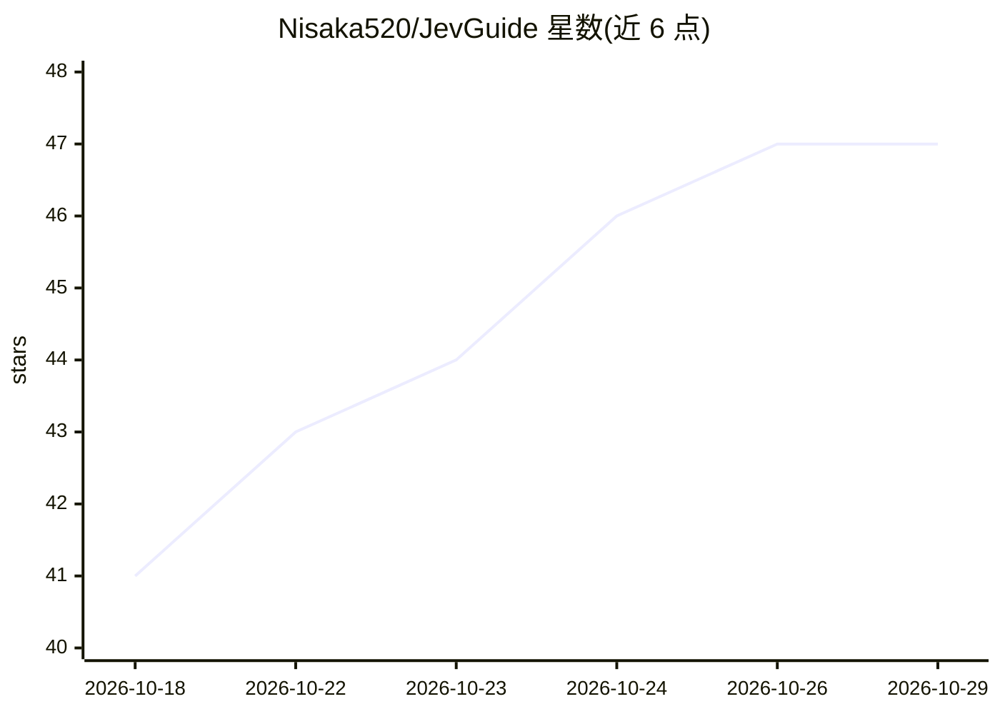

# Nisaka520/JevGuide

⭐ 47 · Kotlin · MIT · 推送 2026-10-08 · [GitHub](https://github.com/Nisaka520/JevGuide) · [官网](https://nisaka520.github.io/JevGuide/) · 个人维护 · 中文 README

**微信聊天关系进展助手：读屏判读+攻略度+3条候选回复**

Android 无障碍应用，面向微信用户：通过无障碍树或截屏+视觉模型两条路读取聊天内容，调用 Jev 接口做意图/情绪判读并计算 0-100% 攻略度，再由聊天模型生成 3 条候选回复文案；攻略度以悬浮条常驻屏幕。每联系人维护本地记忆（摘要+关键事实+历史评分）。不改微信、不发消息、不注入点击。需自配 Jev 密钥与 OpenAI 兼容端点密钥；新版微信屏蔽无障碍树后只能走视觉读屏（截图发往用户配置的端点）。提供 APK 下载与源码构建两种安装方式，不需要 root。

## 筛选速览

| 维度 | 判定 | 备注 |
|---|---|---|
| AI 角色 | `ai-native` | 本体是模型或模型工具 |
| 许可风险 | `permissive` | MIT |
| 部署形态 | `None` |  |
| 模型依赖 | locked-api |  |
| 硬件要求 | — | 无带数字的原话,不猜 |
| 安装摩擦 | `medium` | 含编译或系统依赖之一 |
| 成熟度 | — | 结构信号不足 |

## 能力要点

- 无障碍树 / 截屏视觉两条读屏路径，按设置自动切换
- Jev 判读 + 10 档攻略度评分，结果常驻悬浮条
- 每联系人本地长期记忆（摘要+关键事实+历史评分），仅存本机
- 内置国内 7 家厂商预设，支持任意 OpenAI 兼容端点

## 适用场景

- 微信聊天时实时查看关系攻略度并获取候选回复文案
- 通过截屏视觉模型读取新版微信的聊天内容
- 为每个联系人维护仅存本机的聊天记忆

## 场景标签

`AI 写作` · 领域:内容生成

## 证据(README 行号)

> L3: 微信聊天里的**关系进展助手**：读屏 → Jev 判读 + 攻略度评分 → 聊天模型出 3 条候选回复，攻略度**常驻挂在屏幕上**。
> L50: 好消息是**截屏能拍到**（不是 `FLAG_SECURE`），所以本项目多了第二条路：**截图 → 视觉模型念成文字**。
> L129: 3 条文案也用真模型跑过（`gpt-5.6-luna` / `gpt-oss-120b`），都稳定输出 3 段并**用上了记忆**：

## 星数曲线

2026-10-18 41 → 2026-10-29 47（+6）

---
*卡片 v1 · prompt 1.4 · 生成 2026-10-25 · 置信度 high · 依据 README sha `fd5513f68ef4` · [字段定义](../../DATASET.md)*
