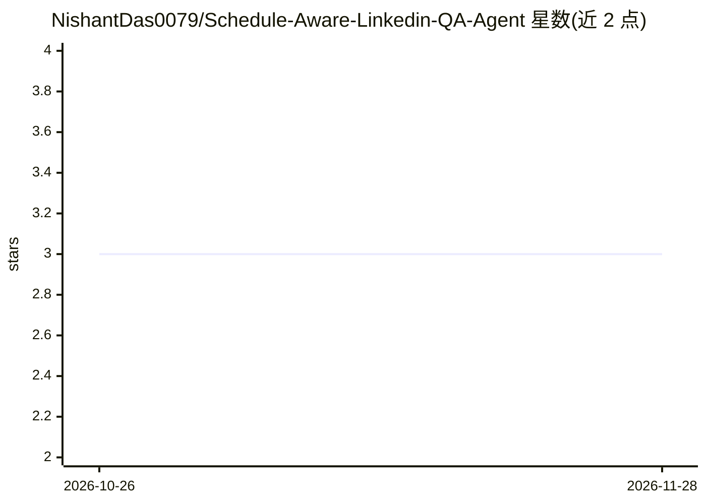

# NishantDas0079/Schedule-Aware-Linkedin-QA-Agent

⭐ 3 · MIT · 推送 2026-11-16 · [GitHub](https://github.com/NishantDas0079/Schedule-Aware-Linkedin-QA-Agent) · 个人维护

**围绕课表排期的 LinkedIn 发帖人审 QA 工作流**

由两个 n8n workflow 组成：其一把非结构化课表（PDF/截图/Excel 等）转为 Google Calendar 课表事件；其二对 LinkedIn 草稿做 LLM 改写与打分，依据日历空闲推荐 30 分钟发布时段。核心机制是人在回路：每个不可逆动作都经 Gmail 审批门，确定性 IF 节点强制校验分数阈值、JSON schema、冲突标志，修订上限 3 次，决策写入 Notion 审计。仓库目前仅含文档与许可证，未发布可导入的 workflow JSON，无法据此复现。

## 筛选速览

| 维度 | 判定 | 备注 |
|---|---|---|
| AI 角色 | `ai-native` | 本体是模型或模型工具 |
| 许可风险 | `permissive` | MIT |
| 部署形态 | `None` |  |
| 模型依赖 | — | README 未给出锁定关系 |
| 硬件要求 | — | 无带数字的原话,不猜 |
| 安装摩擦 | `low` | 无编译、无系统依赖或容器化 |
| 成熟度 | `idea` | |

## 能力要点

- LLM 提议、确定性逻辑校验、人工批准的三层安全契约（8 条 guardrail）
- Gmail 审批门：工作流暂停直至人工回复 Approve/CHANGES/Reject
- 质量门为确定性 IF 节点（score≥8、schema、冲突检查），修订上限 3 次
- 全部决策记录到 Notion 审计日志

## 适用场景

- 学生把发帖时间自动避开上课时段
- 需要每步人工审批才执行发布的 LLM 内容流水线
- 用 Notion 审计 AI 内容的批准/修订/拒绝记录

## 场景标签

`工作流自动化` `AI 写作` · 领域:效率与自动化

## 证据(README 行号)

> L14: **What it does.** This project turns a rough LinkedIn draft into a scored, scheduled, human-approved publishing eve
> L38: The central question this project answers is: *how do you let an LLM help with a real-world action without ever let

## 星数曲线

2026-10-26 3 → 2026-11-28 3（+0）

---
*卡片 v1 · prompt 1.4 · 生成 2026-11-22 · 置信度 high · 依据 README sha `93d901a5beb0` · [字段定义](../../DATASET.md)*
