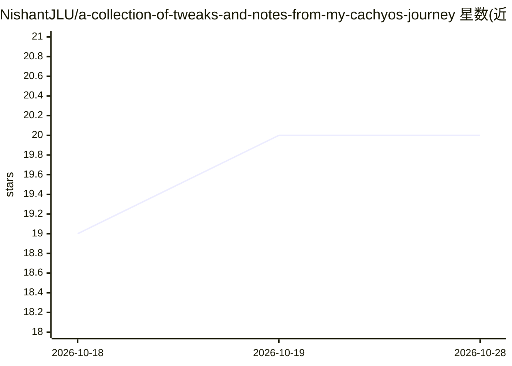

# NishantJLU/a-collection-of-tweaks-and-notes-from-my-cachyos-journey

⭐ 20 · Shell · MIT · 推送 2026-06-26 · [GitHub](https://github.com/NishantJLU/a-collection-of-tweaks-and-notes-from-my-cachyos-journey) · [官网](https://cachyos.org) · 个人维护

**CachyOS 本地 AI Agent 环境搭建与系统调优指南**

面向 CachyOS/Arch 用户的双主题仓库：一是本地 AI Agent 环境的完整搭建指南，覆盖 Hermes Agent（Nous Research）安装、Ollama 各 GPU 后端（CUDA/ROCm/Vulkan/CPU）配置、hermes3:8b 模型拉取及自定义系统级技能；二是 CachyOS 系统优化，含内核选择（BORE/EEVDF 调度器）、NVIDIA/AMD/Intel 硬件配置、BTRFS/ZRAM 内存压缩与游戏工具。提供自动化 setup.sh 脚本，可检测 GPU 类型并完成依赖安装、服务启用与 Agent 部署。限制：要求裸机安装，不支持 VM 环境；需熟悉 pacman 包管理。

## 筛选速览

| 维度 | 判定 | 备注 |
|---|---|---|
| AI 角色 | `ai-knowledge` | 知识聚合/清单类 |
| 许可风险 | `permissive` | MIT |
| 部署形态 | `None` |  |
| 模型依赖 | local-ok | 支持本地模型 |
| 硬件要求 | — | 无带数字的原话,不猜 |
| 安装摩擦 | `medium` | 含编译或系统依赖之一 |
| 成熟度 | — | 结构信号不足 |

## 能力要点

- 自动化 setup.sh：检测 GPU 类型并配置 Ollama、驱动与 Hermes Agent
- Ollama 按 GPU 后端（CUDA/ROCm/Vulkan/CPU）分类安装指引
- NVIDIA/AMD/Intel 三类硬件配置档案与自定义技能（cachyos_system_info 等）
- CachyOS 内核选型对比（BORE/EEVDF/LTS/RT/加固版）

## 适用场景

- 在 CachyOS 上搭建本地运行的 Hermes Agent 与 Ollama 推理环境
- 为本地 LLM 推理和低延迟游戏调优内核与内存配置
- 按自身 GPU 类型（NVIDIA/AMD/Intel）完成驱动与加速配置

## 场景标签

`教程课程` · 领域:学习与行业

## 证据(README 行号)

> L15: This repository serves a dual purpose:
> L16: 1. **Local AI Agent Environment**: A complete guide to setting up **Hermes Agent** (by Nous Research) on CachyOS wi

## 星数曲线

2026-10-18 19 → 2026-10-28 20（+1）

---
*卡片 v1 · prompt 1.4 · 生成 2026-10-28 · 置信度 high · 依据 README sha `3981acaed297` · [字段定义](../../DATASET.md)*
