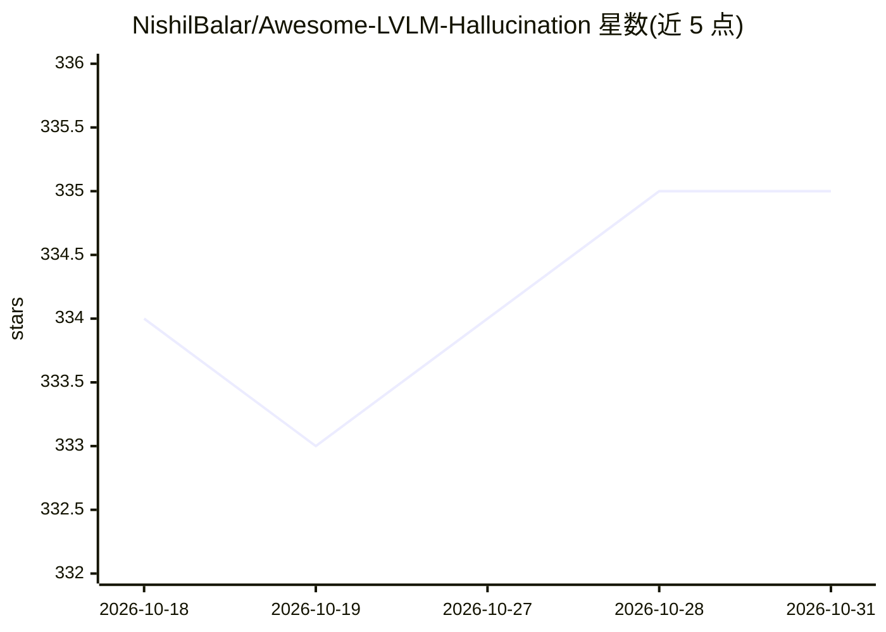

# NishilBalar/Awesome-LVLM-Hallucination

⭐ 335 · 推送 2026-08-28 · [GitHub](https://github.com/NishilBalar/Awesome-LVLM-Hallucination) · 个人维护

**LVLM 幻觉研究论文与基准的策展清单**

策展 LVLM/MLLM 幻觉研究论文、代码与简述的 awesome 清单，按评测基准维度组织 42 个条目（CHAIR、POPE、MME、HallusionBench、AMBER 等），每条列出会议/日期、核心贡献要点（数据集规模、评测指标、方法），部分新条目仅标注标题待补充。面向 multimodal 模型幻觉方向的研究者，通过 issue 接受贡献。仓库本身不提供代码或安装方式。

## 筛选速览

| 维度 | 判定 | 备注 |
|---|---|---|
| AI 角色 | `ai-knowledge` | 知识聚合/清单类 |
| 许可风险 | `none` | — |
| 部署形态 | `None` |  |
| 模型依赖 | — | README 未给出锁定关系 |
| 硬件要求 | — | 无带数字的原话,不猜 |
| 安装摩擦 | `low` | 无编译、无系统依赖或容器化 |
| 成熟度 | — | 结构信号不足 |

## 能力要点

- 42 个幻觉评测基准条目，含会议与日期信息
- 每条附数据集规模、评测指标或方法要点（如 POPE 的三种设置、AMBER 的 LLM-free 评测）
- 覆盖对象、属性、关系、医学等多类幻觉子方向

## 适用场景

- 查找 LVLM 幻觉检测/评测的基准论文
- 比较各幻觉评测数据集的规模与指标设计
- 跟踪 2018–2024 幻觉研究工作的时间线

## 场景标签

`精选清单` · 领域:学习与行业

## 证据(README 行号)

> L5: This repository will provide an organized list of state-of-the-art research papers, relevant code, and a brief descr
> L11: ## Evaluation-Benchmark

## 星数曲线

2026-10-18 334 → 2026-10-31 335（+1）

---
*卡片 v1 · prompt 1.4 · 生成 2026-10-22 · 置信度 high · 依据 README sha `7a9ff6c3f186` · [字段定义](../../DATASET.md)*
