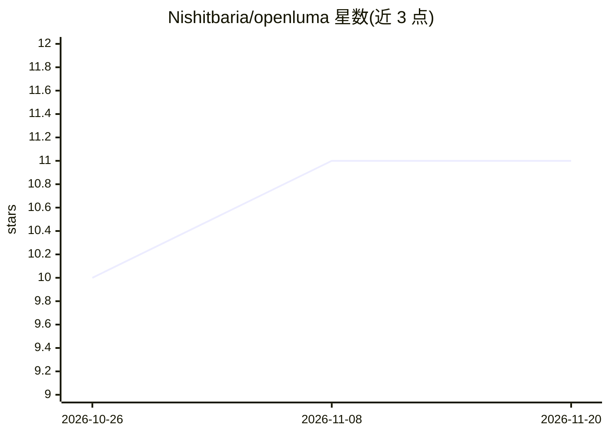

# Nishitbaria/openluma

⭐ 11 · TypeScript · MIT · 推送 2026-11-04 · [GitHub](https://github.com/Nishitbaria/openluma) · [官网](https://openluma.vercel.app) · 个人维护

**开源自托管活动管理平台，AI 对话式创建与管理活动**

以 Lu.ma 为灵感开源的活动管理平台，提供面向主办者与参与者的完整 Web UI，并内置 AI Agent 通过自然语言对话完成活动的创建、编辑、搜索、RSVP 提交与邀请发送（10 个工具，多 Agent 委派模式，基于 Vercel AI SDK 与 OpenAI GPT-4o-mini）。功能覆盖 RSVP 审批/候补、QR 码票务与签到、邮件通知与 ICS 附件、角色权限、Google OAuth 登录。需 Node.js 18+、PostgreSQL、Bun 及多项第三方服务凭据（Upstash Redis、Resend、Uploadthing），Docker 部署文件尚未提供。

## 筛选速览

| 维度 | 判定 | 备注 |
|---|---|---|
| AI 角色 | `ai-enhanced` | 去掉 AI 部分产品仍成立 |
| 许可风险 | `permissive` | MIT |
| 部署形态 | `self-host` | docker 或自建部署 |
| 模型依赖 | — | README 未给出锁定关系 |
| 硬件要求 | — | 无带数字的原话,不猜 |
| 安装摩擦 | `low` | 无编译、无系统依赖或容器化 |
| 成熟度 | — | 结构信号不足 |

## 能力要点

- AI Agent 支持 10 个活动操作工具（创建/编辑/删除/搜索/RSVP/邀请）
- RSVP 审批、候补与 QR 码票务签到及审计记录
- 基于 Better Auth 的 Google OAuth 与角色权限体系
- MIT 许可，可自托管部署到任意 Next.js 平台

## 适用场景

- 自托管搭建活动报名与票务系统
- 通过自然语言对话管理活动与发送邀请
- 为社区活动提供 QR 码签到与角色协作

## 场景标签

 · 领域:活动管理/协作工具

## 证据(README 行号)

> L8: An open-source event management platform inspired by Lu.ma, built with Next.js 16, AI-powered event creation, and a 
> L10: > **Use natural language to create, manage, and discover events.** OpenLuma features an AI agent that handles event
> L16: - **AI-Powered Event Management**: Create, edit, search, and manage events through natural language conversation

## 星数曲线

2026-10-26 10 → 2026-11-20 11（+1）

---
*卡片 v1 · prompt 1.4 · 生成 2026-11-19 · 置信度 mid · 依据 README sha `7d026971bcad` · [字段定义](../../DATASET.md)*
