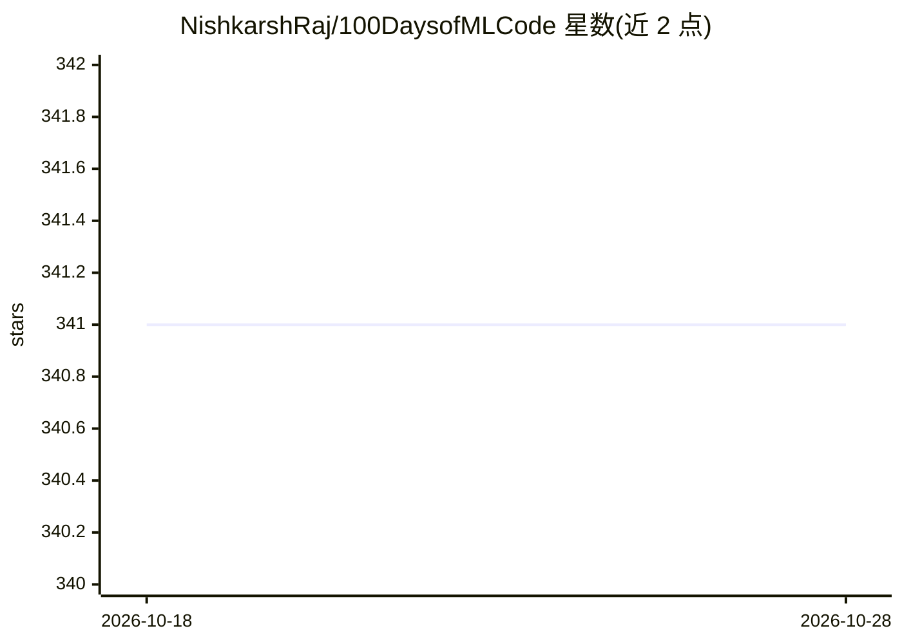

# NishkarshRaj/100DaysofMLCode

⭐ 341 · Jupyter Notebook · MIT · 推送 2026-02-16 · [GitHub](https://github.com/NishkarshRaj/100DaysofMLCode) · [官网](http://github.com/NishkarshRaj) · 个人维护

**个人机器学习百日挑战学习日志与社区贡献项目**

#100DaysofMLCode 挑战的学习记录仓库：作者按日记录机器学习与人工智能领域的学习活动，主题标签覆盖线性回归、分类算法、深度学习、生成式 AI、大数据等。项目以 MIT 许可开源，接受多种形式的社区贡献，已有十余名开发者加入学习记录，并声明遵循贡献指南与行为准则。

## 筛选速览

| 维度 | 判定 | 备注 |
|---|---|---|
| AI 角色 | `ai-knowledge` | 知识聚合/清单类 |
| 许可风险 | `permissive` | MIT |
| 部署形态 | `None` |  |
| 模型依赖 | — | README 未给出锁定关系 |
| 硬件要求 | — | 无带数字的原话,不猜 |
| 安装摩擦 | `low` | 无编译、无系统依赖或容器化 |
| 成熟度 | — | 结构信号不足 |

## 能力要点

- 按日记录的机器学习学习日志
- MIT 许可的开放贡献项目
- 主题覆盖线性代数、分类、深度学习、生成式 AI 等

## 适用场景

- 跟随他人学习路径自学机器学习基础
- 以贡献方式参与百日学习挑战并记录自己的进展
- 查找分类、回归等基础算法的学习素材线索

## 场景标签

`教程课程` · 领域:学习与行业

## 证据(README 行号)

> L7: ## Log of my Day-to-Day Activities
> L13: This is an open project and contribution in all forms are welcomed.

## 星数曲线

2026-10-18 341 → 2026-10-28 341（+0）

---
*卡片 v1 · prompt 1.4 · 生成 2026-10-21 · 置信度 mid · 依据 README sha `72e8dbab4f6c` · [字段定义](../../DATASET.md)*
